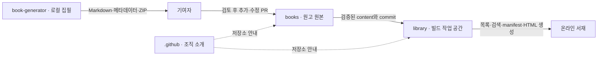

# AI Generation Library 저장소 역할

책 콘텐츠, 독자 서비스, 로컬 집필 도구와 조직 소개를 별도 저장소로 관리합니다. 책 목록은 메타데이터로 생성하므로 소개 README에 개별 책이나 책 수를 기록하지 않습니다.

| 저장소 | 책임 | 구현 |
| --- | --- | --- |
| `books` | 원고, 목차, `book.json`, 출처·검증, 실습, 다운로드, 책 기여 PR | 콘텐츠 저장소 전환 |
| `library` | 검색, 카테고리, 웹 뷰어, 진도, 디자인, 빌드·배포 | 기존 Quartz 서재 이전 |
| `book-generator` | AI 기획·목차·장 원고 작성 파이프라인 | 자신의 API 키로 실행하는 로컬 웹 화면·CLI |
| `.github` | 조직 소개 README, 공통 기여 안내, Issue 템플릿, 커뮤니티 정책 | 조직 소개 게시, 공통 정책·템플릿은 확장 예정 |

## 데이터 흐름

`books`의 `content/<id>/book.json`, 목차와 원고를 유일한 원본으로 관리합니다. 웹 홈, `library-manifest.json`, 책별 `book-manifest.json`, 검색 인덱스와 HTML은 `library`가 생성합니다. 서비스 빌드는 원본 체크아웃을 수정하지 않고 복사한 작업 콘텐츠만 갱신합니다.

## books → library 계약

1. `books` PR은 Python 검사로 모든 책의 메타데이터·번호·경로를 확인합니다. 실습 검사와 설명 리뷰 결과를 책의 검증 안내에 기록합니다.
2. `library`는 `books`를 별도 디렉토리에 체크아웃하고 사용한 commit을 빌드에서 식별합니다.
3. 서비스는 `scripts/book_metadata.py`의 `load_books(root)`로 전체 책을 검증합니다. 함수는 `(책 경로, 메타데이터)` 목록을 반환하며 원본에 쓰지 않습니다.
4. 검증한 `content/<id>/`를 서비스 작업 공간으로 복사합니다. 서비스 홈·assets와 결합해 manifest·카드·검색을 생성합니다.
5. 정적 빌드와 내부 링크 검사를 통과한 결과를 `library`의 Pages로 배포합니다.

특정 `books` commit을 선택해 서비스 코드와 콘텐츠를 함께 재현할 수 있어야 합니다. 서비스 `main` push와 수동 실행은 빌드·배포의 기본 경로이며 콘텐츠 갱신 감지는 서비스 워크플로에서 관리합니다. 두 저장소에 같은 원고를 수동으로 유지하지 않습니다.

## book-generator 입력·출력

입력에는 id·제목·대상 독자·범위·목차와 참고 자료를 포함합니다. 생성기는 `CONTENT-FORMAT.md`에 맞춰 Markdown·예제·검증 안내와 `book.json`을 출력합니다. 생성 도구·모델·날짜·입력 자료를 기록하고 수행하지 않은 실습은 미검증으로 남깁니다.

OpenAI Responses, Claude Messages, Gemini generateContent를 지원합니다. 사용자가 자신의 키와 모델을 입력하고 로컬 웹 화면 또는 CLI에서 실행합니다. 키는 실행 중에만 사용하며 설정·체크포인트·원고에 저장하지 않습니다. 출력 예산, 호출 사용량, 중단·재개, 파일 형식 검사와 ZIP을 제공합니다.

`book-generator export`는 완성된 새 책을 books 체크아웃에 복사하며 같은 id를 덮어쓰지 않습니다. 기여자가 내용을 검토한 뒤 PR로 제출합니다. 자동 PR 생성과 배포는 수행하지 않습니다. 서비스 코드나 배포 manifest를 생성하지 않으며 콘텐츠 검사와 리뷰를 거쳐 병합된 원고를 `library`가 읽습니다.

## 조직 .github 설계

`.github/profile/README.md`에는 프로젝트 목적과 네 저장소 링크, 생성기 사용 흐름을 둡니다. 개별 책 목록은 온라인 서재로 안내합니다. 공통 기여 정책, 오류 보고·새 책 제안 Issue 템플릿과 커뮤니티 정책은 확장할 영역입니다. 책 형식·콘텐츠 기여 상세는 `books`, 서비스 개발 상세는 `library`, 생성기 개발 상세는 `book-generator`에 유지합니다.

## 이전 기준

기존 원고·목차·부록·실습·ZIP과 `books`의 CC0 LICENSE를 보존합니다. Quartz·플러그인·테마·Node 의존성과 MIT 라이선스는 `library`에서 관리합니다. 독자 서비스의 기본 주소는 `/library/`입니다. 이전 저장소의 Pages 스냅샷은 별개이며 현재 기본 주소로 안내합니다.
