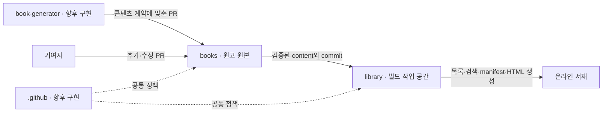

# AI Generation Library 저장소 역할

책 콘텐츠와 독자 서비스를 분리합니다. 이번 구현 범위는 `books`의 원고·검증 도구와 `library`의 기존 웹 서재 이전입니다. `book-generator`와 조직 `.github`는 역할·연동 계약을 설계하고 구현은 이후 진행합니다.

| 저장소 | 책임 | 이번 범위 |
| --- | --- | --- |
| `books` | 원고, 목차, `book.json`, 출처·검증, 실습, 다운로드, 책 기여 PR | 콘텐츠 저장소 전환 |
| `library` | 검색, 카테고리, 웹 뷰어, 진도, 디자인, 빌드·배포 | 기존 Quartz 서재 이전 |
| `book-generator` | AI 기획·목차·장 원고 작성 파이프라인 | 역할·입출력 설계 |
| `.github` | 조직 소개 README, 공통 기여 안내, Issue 템플릿, 커뮤니티 정책 | 역할 설계 |

## 데이터 흐름

`books`의 `content/<id>/book.json`, 목차와 원고를 유일한 원본으로 관리합니다. 웹 홈, `library-manifest.json`, 책별 `book-manifest.json`, 검색 인덱스와 HTML은 `library`가 생성합니다. 서비스 빌드는 원본 체크아웃을 수정하지 않고 복사한 작업 콘텐츠만 갱신합니다.

## books → library 계약

1. `books` PR은 Python 검사로 모든 책의 메타데이터·번호·경로를 확인합니다. 실습 검사와 설명 리뷰 결과를 책의 검증 안내에 기록합니다.
2. `library`는 `books`를 별도 디렉토리에 체크아웃하고 사용한 commit을 빌드에서 식별합니다.
3. 서비스는 `scripts/book_metadata.py`의 `load_books(root)`로 전체 책을 검증합니다. 함수는 `(책 경로, 메타데이터)` 목록을 반환하며 원본에 쓰지 않습니다.
4. 검증한 `content/<id>/`를 서비스 작업 공간으로 복사합니다. 서비스 홈·assets와 결합해 manifest·카드·검색을 생성합니다.
5. 정적 빌드와 내부 링크 검사를 통과한 결과를 `library`의 Pages로 배포합니다.

특정 `books` commit을 선택해 서비스 코드와 콘텐츠를 함께 재현할 수 있어야 합니다. 서비스 `main` push와 수동 실행은 빌드·배포의 기본 경로이며 콘텐츠 갱신 감지는 서비스 워크플로에서 관리합니다. 두 저장소에 같은 원고를 수동으로 유지하지 않습니다.

## book-generator 입력·출력 설계

입력에는 id·제목·대상 독자·범위·목차와 참고 자료를 포함합니다. 생성기는 `CONTENT-FORMAT.md`에 맞춰 Markdown·예제·검증 안내와 `book.json`을 출력합니다. 생성 도구·모델·날짜·입력 자료를 기록하고 수행하지 않은 실습은 미검증으로 남깁니다.

출력은 `books`에 새 책 또는 수정 PR로 제안합니다. 서비스 코드나 배포 manifest를 생성하지 않습니다. 콘텐츠 검사와 리뷰를 거쳐 병합된 원고를 `library`가 읽습니다. 상세 AI orchestration·API 연동·PR 자동 생성은 이번에 구현하지 않습니다.

## 조직 .github 설계

향후 `.github/profile/README.md`에는 프로젝트 목적과 네 저장소 링크를 둡니다. 공통 기여 정책, 오류 보고·새 책 제안 Issue 템플릿과 커뮤니티 정책을 조직 기본 파일로 관리합니다. 책 형식·콘텐츠 기여 상세는 `books`, 서비스 개발 상세는 `library`에 유지합니다. 이번에 조직 저장소를 만들거나 정책 파일을 발행하지 않습니다.

## 이전 기준

FastAPI 30장, 기존 목차 HTML, 부록·실습·ZIP과 `books`의 CC0 LICENSE를 보존합니다. Quartz·플러그인·테마·Node 의존성과 MIT 라이선스는 `library`에서 관리합니다. 기존 `/books/` 사이트 주소는 이전 안내로 연결하고 새 독자 서비스 기본 주소는 `/library/`를 사용합니다.
