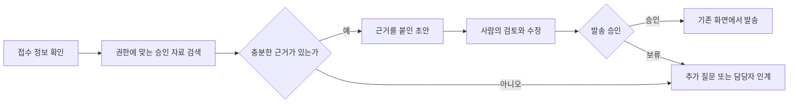

# 10장. 기존 업무 흐름 분석과 재설계

AI가 한 단계의 시간을 줄여도 업무 전체가 빨라지는 것은 아니다. 작성 시간이 줄었지만 검토 대기열이 길어지면 고객이 기다리는 시간은 그대로다. 업무 재설계는 입력부터 완료까지의 흐름을 보며, AI를 넣은 뒤 생기는 새로운 확인과 예외 처리까지 다루는 작업이다.

## 1. 실제 흐름을 관찰하기

절차서와 실제 업무는 다를 수 있다. 담당자가 어떤 화면과 문서를 오가는지, 누구에게 확인을 요청하는지, 왜 작업을 되돌리는지 관찰한다. 고객 문의 한 건에 대해 접수 시각, 작업 시작, 검색, 초안 작성, 검토 요청, 수정, 발송과 종료 시각을 기록한다. 개인정보를 제거한 사건 식별자를 사용하고, 관찰을 직원 감시나 개인 순위 매기기로 바꾸지 않는다.

작업 시간과 대기 시간을 분리한다. 직원이 실제로 처리한 시간은 비용과 작업 부담을 설명하고, 접수부터 종료까지의 시간은 고객 경험을 설명한다. 둘을 합쳐 평균 처리 시간이라고 부르면 개선 원인을 해석하기 어렵다. 재작업 횟수, 담당자 간 이동 횟수, 누락된 입력도 함께 본다.

솔빛서비스에서는 담당자가 자료를 찾지 못해 전문가에게 묻고, 전문가는 고객의 계약 조건을 다시 요청하는 흐름이 있다고 가정한다. 여기에는 검색 문제와 접수 정보 문제라는 두 병목이 있다. AI 검색만 도입하면 두 번째 병목은 남는다.

## 2. 없애기·표준화하기·지원하기 순서로 검토하기

자동화 전에 불필요한 단계를 없앨 수 있는지 묻는다. 같은 정보를 두 번 입력한다면 화면 연결이 우선일 수 있다. 반복 질문이 입력 누락 때문이라면 접수 양식과 안내를 개선한다. 정책이 서로 충돌한다면 문서 소유자가 먼저 해결해야 한다.

남은 단계는 입력과 완료 조건을 표준화한다. 그런 뒤 AI가 검색이나 초안 작성을 지원할 부분을 고른다. 사람의 판단이 필요한 단계를 삭제하려면 판단의 책임, 영향과 예외 처리까지 새로 설계해야 한다. “모델이 알아서 판단한다”는 완료 조건이 아니다.

| 단계 | 개선 질문 | 솔빛서비스의 선택 |
| --- | --- | --- |
| 문의 접수 | 필요한 정보가 처음에 들어오는가 | 제품 버전·문의 유형을 양식에 추가 |
| 자료 검색 | 현재 문서와 공개 범위를 알 수 있는가 | 승인 자료 검색과 버전 표시 |
| 초안 작성 | 사실과 표현을 분리하는가 | 근거를 붙인 초안 제공 |
| 검토 | 검토자가 무엇을 확인하는가 | 근거·공개 범위·고객 맥락 점검 |
| 발송 | 승인과 실제 행동이 연결되는가 | 사람이 기존 발송 화면에서 승인 |
| 종료 | 수정 이유가 다음 개선에 쓰이는가 | 이유 코드와 문서 수정 요청 기록 |

## 3. 정상 경로와 예외 경로를 함께 그리기

예외 경로에는 담당자, 응답 기한과 대체 방식이 필요하다. 모델 오류, 검색 지연, 권한 확인 실패, 자료 충돌을 모두 같은 “다시 시도”로 처리하지 않는다. 권한 확인 실패라면 검색을 중단하고, 일시적인 연결 오류라면 제한된 재시도 후 기존 방식으로 복귀할 수 있다.

검토자는 빨라진 초안을 많이 받아도 충분히 확인할 수 있어야 한다. 한 사람이 처리할 수 있는 검토량을 넘어섰다면 사용량 제한이나 대상 축소가 필요하다. 승인 버튼이 있다는 사실만으로 실질적 통제가 생기지는 않는다.

## 4. 업무 계약으로 흐름을 고정하기

업무 계약은 단계 간 약속이다. 입력 항목, 출력 형식, 성공 조건, 보류 조건, 다음 담당자를 한 장에 적는다. 예를 들어 초안에는 답변, 문서 식별자·버전, 미확인 사항과 권장 행동이 있어야 한다. 발송 가능한 답변과 내부 참고 설명을 같은 칸에 섞지 않는다.

업무 담당자가 실제 사례로 계약을 검토하고 개발자는 그 계약을 화면과 검증 규칙에 반영한다. 수정할 때에는 버전을 올려 어떤 입력·프롬프트·자료·검토 기준이 함께 바뀌었는지 남긴다. 기존 방식으로 돌아갈 경로도 계약의 일부다.

## 5. 작은 흐름부터 비교하기

한 번에 모든 업무를 바꾸면 무엇이 개선에 기여했는지 알기 어렵다. 문의 유형 하나에서 시작해 접수 개선만 적용한 흐름과 AI 지원까지 포함한 흐름을 비교할 수 있다. 실제 운영에서는 고객 영향과 업무 부담을 고려해 비교 설계를 선택한다.

처리 시간 외에 재문의, 수정량, 인계 적절성, 검토 부담을 본다. AI 사용자가 어려운 문의를 피했다면 속도 개선은 선택 편향일 수 있다. 비교 집단의 문의 난이도와 제외 사유를 기록해야 한다.

## 실습: 한 건을 끝까지 추적하기

[업무·프롬프트 계약 양식](../templates/workflow-contract.md)에 현재 흐름과 제안 흐름을 작성한다. 실제 사례 대신 익명화한 업무나 가상 문의 한 건을 선택한다. 각 단계의 입력, 담당자, 작업 시간, 대기, 되돌림 이유를 적고 가장 큰 병목 하나를 고른다. 마지막으로 장애 상황 하나를 넣어 기존 방식으로 끝까지 처리할 수 있는지 확인한다.

## 확인 질문

1. 작성 시간이 줄어도 고객 대기가 줄지 않는 이유는 무엇인가?
2. 제거하거나 표준화할 수 있는 단계를 AI로 자동화하려 하지는 않았는가?
3. 검토자가 승인 전에 확인할 정보와 시간이 충분한가?

다음 장에서는 이 업무 계약을 AI가 수행할 수 있는 지시와 출력 형식으로 바꾼다.
