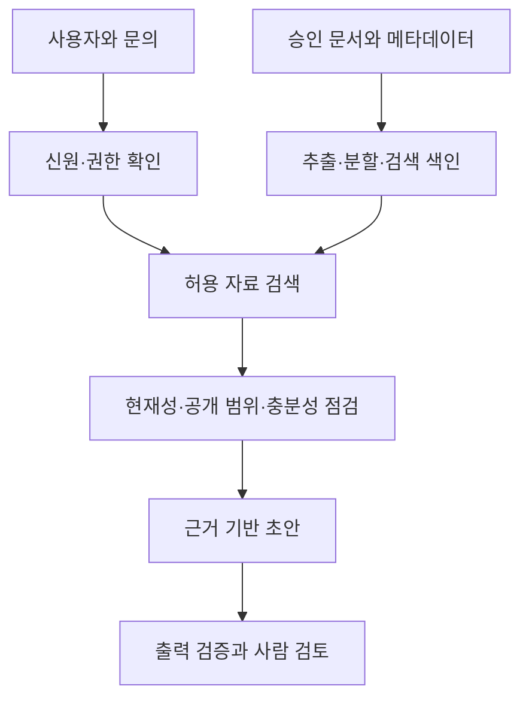

# 17장. 사내 자료를 활용하는 RAG

RAG는 질문에 관련된 자료를 검색하고 그 자료를 모델 입력에 제공해 답변을 만드는 방식이다. 모델이 사내 자료를 영구적으로 외웠다는 의미가 아니다. 검색과 생성이 모두 정확해야 하며, 필요한 자료가 검색되었다고 올바른 답변이 보장되지는 않는다.

## 1. 두 개의 흐름을 구분하기

등록 흐름에서는 원문을 추출하고 문단이나 의미 단위로 나눈 뒤 식별자·버전·권한과 함께 검색 저장소에 넣는다. 질의 흐름에서는 사용자를 확인하고 권한에 맞는 자료를 검색해 모델에 제공한다. 결과를 검증하고 담당자에게 근거와 함께 보여준다.

그림은 설계 개념이다. 실제 제품이 모든 단계를 별도 서비스로 구현해야 한다는 뜻은 아니다. 책임과 검증 지점이 빠지지 않는 것이 중요하다.

## 2. 검색 방법과 문서 분할

키워드 검색은 제품 코드나 정확한 용어에 강하고, 의미 기반 검색은 다른 표현의 유사한 질문을 찾는 데 도움이 된다. 둘을 결합하거나 검색 결과를 재정렬할 수 있다. 어떤 방식이 좋은지는 업무 질문으로 확인한다.

문서를 너무 잘게 나누면 조건과 예외가 떨어지고, 너무 크게 나누면 불필요한 내용이 늘어난다. 제목, 적용 대상과 각주를 보존하며 문단을 분할한다. 조각에는 원문 위치와 문서 ID를 붙인다. 겹치는 내용은 검색 중복을 만들 수 있으므로 검토한다.

가상의 “버전 3부터 제공”이라는 안내에서 버전 조건이 빠지고 기능 설명만 검색되면 오래된 제품에도 지원한다고 답할 수 있다. 모델을 바꾸기 전에 검색된 조각을 확인해야 한다.

## 3. 권한은 생성 전에 집행하기

검색은 사용자·조직·업무 목적에 맞는 범위로 제한한다. 민감한 자료를 모두 모델에 넣은 뒤 “답하지 말라”고 지시하는 방식은 충분한 경계가 아니다. 외부 답변에는 공개 가능한 근거만 제공하는 경로를 별도로 둘 수 있다.

솔빛서비스의 담당자가 내부 보안 문서를 읽을 수 있어도 고객 답변 초안에는 공개 FAQ와 승인 안내만 사용한다. 제한 자료를 근거로 외부 문장을 만드는 것은 위험하다. 권한 실패는 빈 검색 결과와 구분해 내부 기록에 남기되 고객에게 자료의 존재나 비밀 제목을 불필요하게 노출하지 않는다.

캐시 키에도 사용자·조직·권한·자료 버전을 고려한다. 같은 질문의 답변을 다른 고객에게 재사용하면 권한 경계를 넘을 수 있다. 검색 후 문서의 현재 권한을 다시 확인하는 등 정책 변경에 대응할 경로를 둔다.

## 4. 검색 실패와 생성 실패를 나눠 평가하기

정답에 필요한 문서가 검색되지 않았다면 검색·메타데이터·문서 품질을 먼저 본다. 올바른 자료가 있었는데 모델이 다른 정책을 만들었다면 생성 지시와 출력 검증을 본다. 인용 링크가 틀리거나 근거가 주장을 지지하지 않는 문제도 별도로 기록한다.

평가에서는 기대 문서, 검색 결과, 답변의 주장과 인용을 연결한다. 검색 순위가 높은 문서가 항상 정답 근거는 아니며 유사도 점수는 사실 확률이 아니다. 검색 기준을 바꾸면 보류율과 잘못된 답변도 함께 확인한다.

## 5. 자료가 없을 때의 행동

질문에 맞는 근거가 없으면 추가 질문이나 인계로 이어진다. 검색 결과가 있다는 이유만으로 답변을 완성하지 않는다. 자료가 오래되었거나 충돌하는 경우도 보류 대상이다. 담당자가 문서 누락을 등록하고 소유자가 개선하도록 연결한다.

사용자의 잘못된 전제를 그대로 받아들이지 않는다. 없는 기능을 어떻게 켜는지 묻는 질문에는 기능 존재를 먼저 확인한다. 외부 지식이 필요한 질문을 내부 자료만으로 답할 수 없다면 범위 밖임을 안내한다.

## 실습: 생성 이전을 확인하기

[가상 문서와 평가 사례](../examples/README.md)에서 일반 문의와 제한 정보 문의를 하나씩 고른다. 사용자 접근 범위와 외부 공개 범위를 정하고 검색 가능한 문서를 수작업으로 고른다. 그 자료만으로 답할 수 있는지 판단한다. 이 실습은 설계를 확인하며 실제 검색·모델 성능 실험을 대신하지 않는다.

## 확인 질문

1. 문서 조각에 조건·버전·근거 위치가 보존되는가?
2. 자료가 없어서 못 답한 것과 권한 때문에 중단한 것을 구분하는가?
3. 생성 실패와 검색 실패를 따로 개선할 수 있는가?

다음 장에서는 답변을 넘어 도구를 호출하는 에이전트의 행동 경계를 다룬다.
