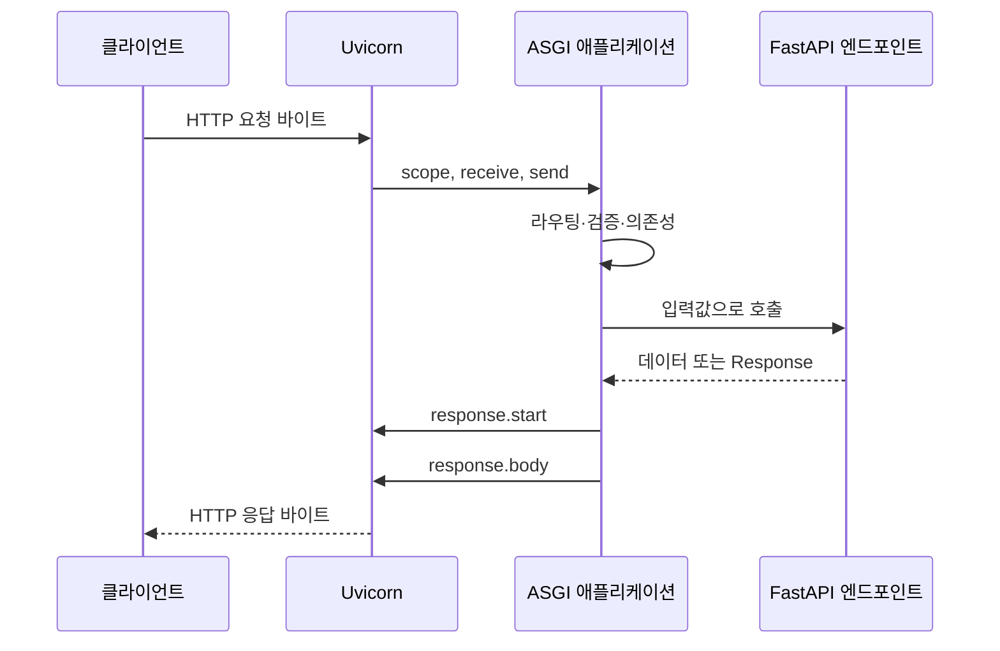

> PART 2. FastAPI 내부 동작 원리 · 핵심 장

## 학습 목표와 도입 사례

HTTP 요청이 네트워크 바이트에서 Python 함수 호출이 되고 다시 응답으로 나가는 과정을 설명한다. ASGI의 세 인자를 직접 사용하고, HTTP 요청 수명과 TCP 연결 수명, lifespan의 차이를 구분한다.

Knowledge Hub가 긴 답변을 스트리밍하는 도중 사용자가 창을 닫았다. 서버 로그는 요청이 종료되었다고 보이지만 모델 호출은 계속 비용을 발생시킨다. 이 문제를 이해하려면 “함수가 문자열을 반환한다”보다 아래에 있는 메시지 흐름을 알아야 한다. ASGI는 그 흐름을 서버와 애플리케이션 사이의 계약으로 표현한다.

## 5.1 WSGI와 ASGI의 차이

WSGI의 대표 인터페이스는 `application(environ, start_response)`다. 애플리케이션이 요청 환경을 받아 상태·헤더를 설정하고 바이트 iterable을 반환한다. 동기적인 호출 규약이 중심이다. WSGI 서비스도 여러 프로세스나 스레드로 동시 요청을 처리할 수 있다. WSGI라는 이유만으로 서버 전체가 요청을 하나씩 처리한다고 단정하면 안 된다.

ASGI 3의 애플리케이션은 비동기 callable이다. `scope`, `receive`, `send`를 받아 요청 메타데이터와 이벤트를 읽고 응답 이벤트를 보낸다. HTTP 외에 WebSocket처럼 긴 연결의 양방향 메시지를 표현하기에도 적합하다. 계약의 세 요소와 프로토콜별 수명은 [ASGI 기본 명세](https://asgi.readthedocs.io/en/latest/specs/main.html)를 기준으로 확인한다.

비동기 계약은 애플리케이션이 I/O 대기 때 다른 작업에 실행 기회를 줄 수 있게 한다. 그것이 모든 코드의 자동 비동기화를 뜻하지는 않는다. 동기 SQL 드라이버나 긴 CPU 계산은 별도 실행 경계가 필요하다. ASGI 채택과 CPU 병렬 처리 능력은 다른 질문이다.

| 구분 | WSGI의 대표 모델 | ASGI의 대표 모델 |
|---|---|---|
| 호출 | 동기 callable | async callable |
| 입력 | 요청 환경과 입력 스트림 | scope와 receive 이벤트 |
| 출력 | 상태 설정과 바이트 iterable | send 이벤트 |
| 긴 양방향 연결 | 기본 규약의 중심이 아님 | 프로토콜 이벤트로 표현 |
| 동시성 | 배포 서버의 스레드·프로세스 구성 | 이벤트 루프와 필요 시 스레드·프로세스 |

## 5.2 Uvicorn의 역할과 서버 실행 과정

Uvicorn은 소켓을 받아 HTTP 처리를 수행하고 ASGI 애플리케이션을 실행한다. `python -m uvicorn main:app` 명령은 모듈을 찾고 객체를 가져오고 서버 구성을 적용한다. lifespan 시작을 처리하고 요청을 받을 준비를 한다. 실제 시작 순서의 세부 구현은 버전과 워커 구성에 따라 달라질 수 있지만 책임 경계는 같다.

서버의 HTTP 파서와 이벤트 루프 구현은 선택한 옵션과 플랫폼에 영향을 받는다. 모든 플랫폼에서 같은 최적화 라이브러리를 사용할 수 있다고 가정하지 않는다. ASGI 명세가 여러 프로토콜을 표현한다고 선택한 Uvicorn 구성에 HTTP/2나 HTTP/3 지원이 자동으로 생기는 것도 아니다. 외부 프록시의 프로토콜과 내부 서버의 프로토콜을 따로 확인한다.

프로세스가 여러 개면 각 워커가 자신의 애플리케이션 자원을 가진다. 모델을 메모리에 올리고 DB 풀을 만드는 작업도 워커 수만큼 영향을 줄 수 있다. 시작 로그 하나를 보고 전체 인스턴스가 준비되었다고 판단하기보다 readiness와 프로세스 구조를 확인한다.

## 5.3 HTTP 요청 수신과 파싱

클라이언트가 보낸 바이트에서 서버가 요청 줄, 헤더, 본문을 해석한다. `GET /documents/7?verbose=true`의 경로와 쿼리는 서로 다른 정보다. 서버는 이 정보를 ASGI scope에 담고 본문은 이벤트로 전달한다. 요청 본문 전체가 처음부터 scope에 들어 있는 것은 아니다.

TCP 바이트는 클라이언트의 JSON 객체 경계대로 도착하지 않는다. 한 본문이 여러 조각으로 전달될 수 있다. 반대로 HTTP keep-alive 연결에는 여러 HTTP 요청이 순서대로 들어올 수 있다. TCP 연결 하나와 HTTP 요청 하나를 같은 수명으로 취급하면 메모리와 취소 설계가 틀어진다.

큰 업로드를 `await request.body()`로 읽으면 프레임워크가 전체 본문을 모을 수 있다. 편리하지만 전체 요청 크기에 비례한 메모리가 필요하다. 15장의 업로드 제한과 17장의 스트림 소비는 이 수신 단계까지 고려한다. 모델의 문자열 길이 제한만으로 네트워크 수신 비용이 없어지지 않는다.

## 5.4 ASGI의 scope, receive, send

`scope`는 프로토콜 타입과 경로·메서드·헤더 같은 메타데이터를 담는 dict다. HTTP에서는 요청 하나의 수명이고 WebSocket에서는 해당 연결의 수명이다. 헤더와 본문은 주로 bytes로 표현되며 Python의 str과 구분해야 한다.

`receive()`는 다음 입력 이벤트를 기다린다. HTTP 본문 이벤트는 `http.request`이고 `body`, `more_body`를 사용해 조각의 이어짐을 표현한다. 연결 종료를 나타내는 이벤트도 있다. 앱이 receive를 영원히 호출하거나 이미 소비한 본문을 두 컴포넌트가 각자 읽으려 하면 요청 흐름을 깨뜨릴 수 있다.

`send()`는 응답 이벤트를 서버에 전달한다. 먼저 `http.response.start`로 상태와 헤더를 보내고, `http.response.body`로 본문을 보낸다. 본문 이벤트를 여러 번 보내면 스트리밍을 표현할 수 있다. 마지막 본문에서 `more_body=False`를 표시한다. `send()`의 완료를 모든 바이트가 사용자의 화면에 표시되었다는 뜻으로 해석하지 않는다. 서버와 OS, 프록시, 클라이언트 사이에 버퍼가 있다.

```text
앱 → send(response.start: 200)
앱 → send(response.body: 첫 조각, more_body=True)
앱 → send(response.body: 둘째 조각, more_body=True)
앱 → send(response.body: 마지막 조각, more_body=False)
```

응답이 시작된 뒤에는 상태를 500으로 바꿔 다시 정상적인 HTTP 오류 응답을 보내는 방식이 성립하지 않는다. 스트리밍 오류는 이벤트 프로토콜이나 연결 종료로 표현해야 한다. 정확한 이벤트 계약은 [HTTP·WebSocket ASGI 명세](https://asgi.readthedocs.io/en/latest/specs/www.html)에 있다.

## 5.5 Starlette의 요청 처리 구조

Starlette는 요청·응답 객체, 라우팅, 미들웨어, 예외 처리, WebSocket 등 웹 기반 구성요소를 제공한다. Request 객체는 ASGI scope와 수신 이벤트 위의 편리한 인터페이스다. Response 객체는 자신을 호출하는 과정에서 ASGI 응답 이벤트를 만든다.

미들웨어는 안쪽 애플리케이션을 감싸는 구조다. 요청은 바깥에서 안으로 들어가고 응답 이벤트는 다시 바깥으로 나온다. 오류 처리 미들웨어의 위치에 따라 처리 가능한 예외가 달라진다. 응답을 보낸 뒤의 오류를 새 JSON 응답으로 감싸는 것은 해결책이 아니다.

요청 본문을 읽는 로깅 미들웨어는 특히 주의한다. 본문을 소비한 뒤 재전달 규칙을 지키지 않으면 엔드포인트가 빈 본문을 받거나 기다릴 수 있다. 민감정보와 큰 본문까지 모두 로깅하는 설계도 피한다. 관찰을 위해 프로토콜 자체를 바꾸지 않아야 한다.

## 5.6 FastAPI의 라우트 매칭 과정

경로와 메서드가 매칭되면 FastAPI는 선언된 입력과 의존성을 해결하고 엔드포인트를 실행한다. 입력에는 경로·쿼리·헤더·본문 모델이 있고, 의존성은 인증·DB 세션 같은 값을 제공한다. 상세 호출 순서를 외우기보다 각 단계에서 실패할 수 있는 이유를 구분한다.

경로 매칭 실패는 등록 규칙의 문제, 입력 검증 실패는 계약의 문제, 권한 거절은 사용자와 리소스의 문제다. 같은 오류 코드처럼 보여도 해결책이 다르다. 요청 로그에 단계별 타이밍을 연결하면 엔드포인트에 도달하지 못한 요청과 비즈니스 처리 중 실패를 구분할 수 있다.

동기 엔드포인트는 프레임워크가 스레드 실행 경계로 보내고 async 엔드포인트는 비동기 흐름에서 실행한다. 그러나 서비스에서 직접 호출한 동기 helper까지 자동으로 스레드로 옮기지 않는다. 7장에서 이 차이를 실험한다.

## 5.7 응답 생성과 HTTP 전송 과정

엔드포인트가 반환한 모델이나 dict는 선언된 응답 계약에 맞춰 처리되고 HTTP 응답으로 만들어진다. 직접 Response를 반환하는 경로는 처리 방식이 달라진다. 최종 Response는 ASGI send를 통해 상태·헤더·본문을 서버에 전달하고 서버가 네트워크 형식으로 보낸다.

“함수 return”과 “클라이언트가 수신 완료”는 같은 순간이 아니다. 스트리밍 generator는 엔드포인트가 Response를 반환한 뒤에도 계속 실행될 수 있다. 백그라운드 작업도 응답 처리 이후 동작할 수 있다. 자원 정리 시점을 함수 return에만 맞추면 사용 중인 리소스를 닫거나 반대로 지나치게 오래 보유하게 된다.



## 5.8 Lifespan과 애플리케이션 생명주기

lifespan은 요청마다 만드는 자원이 아니라 애플리케이션 실행 동안 사용할 자원을 준비하고 정리하는 경계다. HTTP 클라이언트, DB engine, 모델 핸들 등이 후보가 된다. 요청별 DB 세션은 별도 수명이다. engine 하나를 공유하는 것과 세션 하나를 공유하는 것은 다르다.

**완전 실행 예제.** FastAPI·Uvicorn·HTTPX 환경에서 `lifecycle.py`를 저장한다. 이 코드는 실제 외부 API를 호출하지 않고 클라이언트 수명만 관찰한다.

```python
from contextlib import asynccontextmanager

import httpx
from fastapi import FastAPI, Request

@asynccontextmanager
async def lifespan(app: FastAPI):
    print("startup: HTTP client 생성")
    async with httpx.AsyncClient(timeout=5.0) as client:
        app.state.http = client
        app.state.ready = True
        try:
            yield
        finally:
            app.state.ready = False
            print("shutdown: 준비 상태 해제")
    print("shutdown: HTTP client 닫힘")

app = FastAPI(lifespan=lifespan)

@app.get("/health")
async def health(request: Request):
    return {"ready": request.app.state.ready}
```

`python -m uvicorn lifecycle:app --lifespan on`으로 시작하면 startup 로그가 한 번 출력된다. 건강 검사는 `ready=true`이고 정상 종료하면 클라이언트가 정리된다. 여러 워커에서는 이 과정이 워커별로 실행된다. 테스트에서도 lifespan을 시작하는 도구가 필요하며 HTTPX의 ASGITransport만으로는 자동 실행되지 않는다.

## 기본 실습: 프레임워크 없이 ASGI 구현하기

**완전 실행 예제.** Uvicorn만 설치되어 있어도 된다. 다음을 `raw_asgi.py`에 저장한다. HTTP 본문을 모두 모으는 교육용 구현이므로 큰 파일 수신용이 아니다.

```python
import json

async def app(scope, receive, send):
    if scope["type"] == "lifespan":
        while True:
            message = await receive()
            if message["type"] == "lifespan.startup":
                await send({"type": "lifespan.startup.complete"})
            elif message["type"] == "lifespan.shutdown":
                await send({"type": "lifespan.shutdown.complete"})
                return
    elif scope["type"] != "http":
        raise RuntimeError("unsupported protocol")

    body = bytearray()
    while True:
        message = await receive()
        if message["type"] == "http.disconnect":
            return
        if message["type"] == "http.request":
            body.extend(message.get("body", b""))
            if not message.get("more_body", False):
                break

    content = json.dumps({
        "method": scope["method"],
        "path": scope["path"],
        "body_bytes": len(body),
    }, ensure_ascii=False).encode("utf-8")
    await send({
        "type": "http.response.start",
        "status": 200,
        "headers": [
            (b"content-type", b"application/json; charset=utf-8"),
            (b"content-length", str(len(content)).encode("ascii")),
        ],
    })
    await send({"type": "http.response.body", "body": content, "more_body": False})
```

```powershell
python -m uvicorn raw_asgi:app --host 127.0.0.1 --port 8000 --http h11 --lifespan on
Invoke-RestMethod 'http://127.0.0.1:8000/inspect?x=1' -Method Post -ContentType 'text/plain' -Body 'abc'
```

결과는 메서드 POST, 경로 `/inspect`, body_bytes 3이다. 쿼리 문자열은 path에 포함되지 않는다는 점을 확인한다. 코드의 반환값을 JSON 객체로 바꾸는 것만으로 응답이 만들어지지는 않는다. ASGI 응답은 send 이벤트를 통해 표현했다는 사실이 핵심이다.

## 실무 적용과 성능·주의사항

자원을 세 종류로 분류해 보자. 애플리케이션 수명 자원은 lifespan에서 준비한다. 요청 수명 자원은 의존성에서 생성·정리한다. 긴 작업 수명 자원은 큐 작업이나 스트림의 실제 소비 수명에 맞춘다. 이 분류는 DB·외부 API·AI 모델에도 그대로 적용된다.

서버가 연결 종료를 감지한다고 사용자 코드의 모든 작업이 자동으로 즉시 중단된다고 보장하지 않는다. 코드가 종료 이벤트나 취소를 어떤 방식으로 받는지, 외부 클라이언트가 취소를 어떻게 처리하는지 확인해야 한다. 취소는 요청받은 서버가 이미 실행한 부수효과를 되돌리는 보장도 아니다.

큰 응답을 한 번에 만들어 보내면 생성과 직렬화에 메모리를 쓴다. 스트리밍하면 전체 데이터 보유를 줄일 수 있지만 연결과 generator 수명은 길어진다. 느린 클라이언트 때문에 점유한 자원이 무엇인지 먼저 계산한다. 스트리밍이 항상 더 적은 총자원을 쓰는 것은 아니다.

## 확인 문제와 해설

1. HTTP keep-alive 연결 하나에서 요청 세 번을 보낼 때 HTTP scope는 몇 번 생기는가?
2. response.start를 보낸 뒤 DB 오류가 나면 왜 새 500 응답으로 교체하기 어려운가?
3. lifespan HTTP 클라이언트와 요청별 DB 세션의 공유 규칙이 다른 이유는?
4. 실습: raw ASGI 코드를 가짜 receive 함수로 호출하고 본문 두 조각의 길이를 확인하라.

**해설.** 1번은 요청마다 별도의 HTTP scope이므로 세 번이다. 2번은 상태·헤더 전송이 이미 시작되었기 때문이다. 3번은 클라이언트·engine은 공유 가능한 풀을 제공하지만 세션은 특정 트랜잭션과 변경 상태를 가진 작업 단위이기 때문이다. 4번은 `b"ab"`, `b"c"`와 more_body 값을 순서대로 제공해 body_bytes가 3인지, send 시작과 본문의 순서가 맞는지 확인하면 된다.

## 요약과 다음 장

ASGI는 요청 메타데이터와 비동기 메시지로 서버와 앱을 연결한다. 함수, 요청, 연결, 애플리케이션은 수명이 다르다. 다음 장에서는 receive와 send가 기다리는 동안 다른 작업이 실행되는 원리인 asyncio를 다룬다.

## 공식 참고자료

- [ASGI 기본 명세](https://asgi.readthedocs.io/en/latest/specs/main.html)
- [ASGI HTTP·WebSocket 명세](https://asgi.readthedocs.io/en/latest/specs/www.html)
- [ASGI lifespan 명세](https://asgi.readthedocs.io/en/latest/specs/lifespan.html)
- [Uvicorn 설정](https://www.uvicorn.org/settings/)
- [FastAPI lifespan](https://fastapi.tiangolo.com/advanced/events/)
- [Starlette 미들웨어](https://www.starlette.io/middleware/)

<!-- book-navigation -->

---

[전체 목차](../index.md) · [← 04장 Pydantic과 데이터 검증](../04-pydantic-validation/chapter.md) · [06장 Python asyncio와 이벤트 루프 →](../06-asyncio-event-loop/chapter.md)
