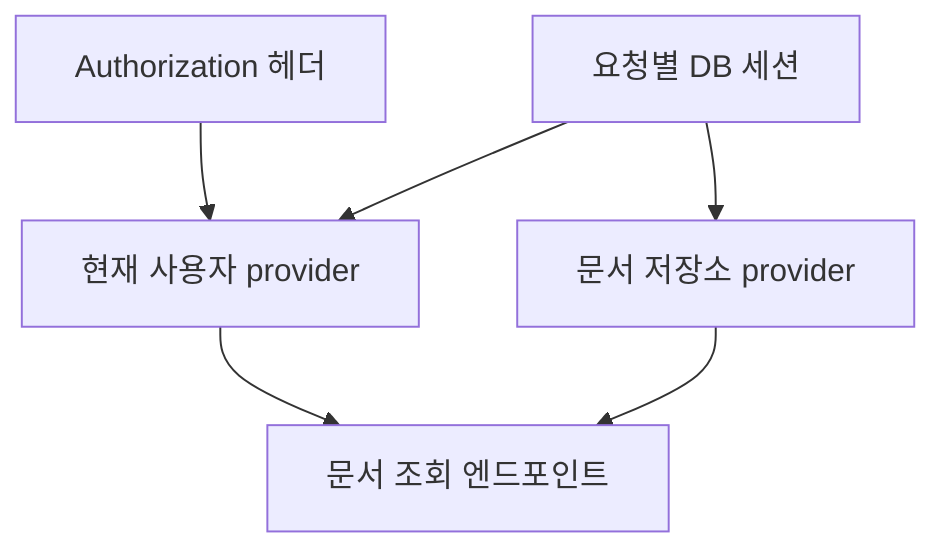

> PART 2. FastAPI 내부 동작 원리 · 핵심 장

## 학습 목표와 도입 사례

Depends의 호출 그래프와 요청별 캐시를 이해하고, yield 의존성의 자원 수명을 선택한다. 미들웨어의 감싸기 구조와 오류 처리 위치를 설명하고 ContextVar로 요청 식별자를 관리한다.

문서 조회 함수에서 매번 토큰을 해석하고 DB 연결을 만들고 마지막에 닫는 코드를 반복했다고 생각해 보자. 한 경로에서 예외가 발생해 닫기 코드가 실행되지 않았다. 다른 경로는 인증을 빠뜨렸다. 공통 동작을 복사하는 대신 필요한 값을 선언하고 제공·정리를 한곳에 모으면 이런 실패를 줄일 수 있다.

## 8.1 Depends의 동작 원리

Depends는 “이 매개변수의 값을 이 callable에서 받아라”라는 선언이다. FastAPI는 함수 서명을 분석해 provider가 요구하는 입력과 하위 의존성을 알아내고 결과를 엔드포인트 매개변수에 전달한다. 인증 사용자·페이지 조건·DB 세션·서비스 객체 등이 후보가 된다.

의존성 주입이 객체를 반드시 싱글턴으로 만든다는 뜻은 아니다. provider가 매번 새 객체를 반환할 수도 있고, lifespan에서 준비한 공유 객체를 반환할 수도 있다. 객체의 수명은 provider의 구현과 캐시 범위가 결정한다. `Depends`라는 이름만 보고 공유 정책을 추측하지 않는다.

provider에는 일반 함수, async 함수, callable 객체 등을 사용할 수 있다. 동기·비동기 함수의 실행 규칙은 7장과 연결된다. provider를 엔드포인트 밖에서 직접 호출하면 의존성 해결이 자동으로 재현되는 것은 아니다. 테스트나 서비스 코드는 필요한 실제 인자를 직접 제공한다.

## 8.2 의존성 그래프와 실행 순서

문서 읽기에는 현재 사용자와 저장소가 필요하고, 현재 사용자에는 검증한 토큰이 필요할 수 있다. 선언은 다음과 같은 그래프가 된다.



하위 의존성의 결과가 있어야 상위 provider를 실행할 수 있다. 그래프의 관계 없는 가지 사이 순서를 비즈니스 규칙의 근거로 삼지 않는다. A를 실행한 다음 B를 해야 한다면 B가 A의 결과에 의존하도록 표현하거나 서비스 안에서 명시적으로 순서를 정한다.

의존성에서 인증이 실패하면 엔드포인트 본문까지 진행하지 않는다. 이 성질을 공통 인증 규칙에 사용할 수 있지만 객체별 권한은 실제 문서 조회와 연결해야 한다. 로그인했는지 검사하는 공통 provider만으로 모든 문서를 읽을 권한이 생기는 것은 아니다.

## 8.3 의존성 캐싱과 요청 범위

같은 요청의 그래프에서 같은 의존성을 반복 사용하면 기본적으로 결과를 재사용할 수 있다. 인증을 위해 DB 세션이 필요하고 저장소도 같은 세션이 필요하다면 별도 세션을 반복 만들지 않게 된다. 이 캐시는 다음 요청까지 인증 사용자나 세션을 보관하는 전역 캐시가 아니다.

`use_cache=False`는 해당 호출에서 재사용을 피하도록 선언한다. 이를 모든 의존성에 붙이면 자원 생성이 중복되고 같은 요청 안에서도 상태가 갈라질 수 있다. 반대로 서로 다른 목적의 provider나 보안 스코프가 있는 경우 동일한 캐시 키라고 단순화하지 않는다. 동일 provider를 반복 사용하는 기본 사례부터 확인한다.

설정 provider에 `lru_cache`를 붙이는 방식은 프로세스 범위의 별도 정책이다. 토큰이나 DB 세션처럼 요청별 상태에 적용하면 안 된다. 요청 캐시와 애플리케이션 캐시를 분리해서 생각한다.

## 8.4 yield를 이용한 리소스 정리

yield 앞에서 자원을 준비하고 yield 값으로 엔드포인트에 제공하고 finally에서 정리한다. FastAPI는 이런 함수를 컨텍스트 매니저처럼 사용한다. 의존성 함수 자체에 `@asynccontextmanager`를 붙여 다른 반환 객체로 바꾸는 식으로 혼동하지 않는다. lifespan의 선언과 의존성 함수의 선언은 사용 방식이 다르다.

이 장은 FastAPI 0.121 이상 기준이다. yield 의존성의 `scope="function"`은 엔드포인트 처리 뒤, 응답 전 정리에 사용하고 `scope="request"`는 응답 전송을 포함한 요청 수명에 사용한다. yield 의존성의 기본은 request 범위다. 버전별 동작과 도입 시점은 [고급 의존성 문서](https://fastapi.tiangolo.com/advanced/advanced-dependencies/)와 [yield 의존성 문서](https://fastapi.tiangolo.com/tutorial/dependencies/dependencies-with-yield/)를 확인한다.

스트리밍 Response가 generator에서 DB 세션을 쓰는데 세션을 function 범위로 먼저 닫으면 수명이 맞지 않는다. 반대로 인증에만 필요했던 세션을 request 범위로 장시간 붙들면 스트림 동안 DB 자원을 낭비할 수 있다. 필요한 데이터를 먼저 읽어 독립된 DTO로 만들고 세션을 닫는 설계를 우선 고려한다.

하위 의존성의 자원이 상위 의존성 정리에 필요하면 하위 자원이 먼저 사라져서는 안 된다. request 범위의 yield 의존성에는 function 범위의 yield 하위 의존성을 두는 조합이 맞지 않는다. 자원 생성과 정리의 그래프를 함께 그린다.

트랜잭션 commit을 응답 이후 finally에 무조건 넣는 설계도 피한다. 사용자는 이미 성공을 받았는데 commit이 실패할 수 있다. 변경 성공 여부는 서비스·엔드포인트의 명시적 트랜잭션 경계에서 결정하고, 의존성은 세션 정리 책임을 갖도록 한다. 예외를 잡았다면 적절하게 재발생시키거나 다른 예외로 변환한다. 오류를 먹고 성공처럼 진행하지 않는다.

## 8.5 중첩 의존성과 공통 인증

토큰을 받는 provider, 검증하는 provider, 현재 사용자를 읽는 provider를 연결할 수 있다. 공통 요구 사항은 라우터 전체에 의존성으로 적용하고, 반환값이 필요하면 매개변수에도 선언한다. 라우터의 dependencies에 선언한 provider는 실행하지만 그 결과가 자동으로 이름 있는 엔드포인트 인자가 되는 것은 아니다.

관리자 권한을 확인하는 provider는 현재 사용자 provider에 의존할 수 있다. 문서 삭제는 관리자 역할만이 아니라 문서 소유권과 상태까지 확인해야 할 수 있다. 역할 기반 검사와 객체 수준 검사를 도메인 규칙에 맞춰 조합한다. 13장에서 실제 토큰 검증을 구현한다.

의존성을 통한 인증은 테스트에서 대체하기 쉽다. 테스트가 반환한 가짜 사용자를 기준으로 권한 분기를 검증할 수 있다. 그러나 모든 인증을 override한 테스트만 있으면 실제 토큰 검증의 오류를 놓친다. 인증 경계 자체의 테스트도 별도로 둔다.

## 8.6 미들웨어의 동작 원리

미들웨어는 요청 처리 전체를 감싸 공통 동작을 적용한다. 요청 ID, 처리 시간, 접근 로그, CORS가 대표 사례다. 입력에 필요한 서비스 객체는 의존성, HTTP 전체에 걸친 공통 처리는 미들웨어라는 기준이 도움이 된다. 꼭 하나만 정답이라는 뜻은 아니다. 데이터가 필요한 시점과 범위를 기준으로 판단한다.

`@app.middleware("http")`는 편리하지만 더 직접적인 이벤트 제어에는 pure ASGI 미들웨어를 사용할 수 있다. pure ASGI는 scope·receive·send를 감싼다. 헤더를 추가할 때는 response.start를, 실제 스트림 완료를 관찰할 때는 마지막 body 이벤트와 앱 종료를 구분한다.

미들웨어 인스턴스는 여러 요청이 함께 사용한다. `self.current_user`, `self.started_at`처럼 요청별 값을 객체 속성에 저장하면 요청이 서로 덮어쓸 수 있다. 요청별 상태는 함수 지역 변수, scope/state, ContextVar에 둔다.

## 8.7 미들웨어 실행 순서와 예외 처리

사용자 미들웨어 A가 B 바깥에 있으면 요청은 A→B→라우터, 응답은 라우터→B→A로 이동한다. FastAPI/Starlette의 add_middleware 방식에서는 나중에 추가한 사용자 미들웨어가 앞서 추가한 사용자 미들웨어 바깥에 놓인다. 프레임워크의 오류 처리 계층까지 포함한 실제 스택은 별도로 이해해야 한다.

```text
바깥 A: 요청 시작
  안쪽 B: 요청 시작
    엔드포인트
  안쪽 B: 응답 관찰
바깥 A: 응답 관찰
```

endpoint의 HTTPException 처리와 사용자 미들웨어에서 발생한 예외는 같은 위치가 아니다. 미들웨어에서 접근을 거절해야 한다면 해당 경계에서 적절한 Response를 반환하는 방식이 명확할 수 있다. 모든 예외를 잡아 `200` 응답으로 만들면 모니터링과 취소·장애 의미가 깨진다.

처리 시간 헤더를 엔드포인트 반환 직후 계산하면 스트림 전체 전송 시간이 아닐 수 있다. 무엇을 측정했는지 이름과 문서에 밝힌다. 이미 응답이 시작된 뒤 발생한 예외는 상태 교체 대신 스트림 오류 정책과 로깅으로 처리한다.

## 8.8 ContextVar와 요청별 상태 관리

ContextVar는 비동기 실행 문맥에 값을 연결한다. 요청 ID를 함수마다 전달하지 않고 로그 formatter에서 읽는 경우에 유용하다. set이 반환한 token으로 finally에서 reset하면 다음 처리 흐름으로 상태가 잘못 남는 일을 줄인다.

새 Task는 생성 시 문맥을 복사할 수 있다. 이것은 영속 작업 저장이 아니다. 큐 작업이나 다른 프로세스에는 필요한 request ID·tenant ID를 명시적으로 데이터로 전달한다. 스레드로 문맥을 복사하는 도구가 있어도 변경 결과가 호출자 문맥으로 자동 역전파된다고 기대하지 않는다.

Starlette의 BaseHTTPMiddleware에는 ContextVar 전파 관련 제약이 문서화되어 있다. 이런 요구가 핵심인 로깅에는 pure ASGI 구현을 검토한다. [Starlette 미들웨어 문서](https://www.starlette.io/middleware/)에서 해당 제약과 스택 구조를 확인한다.

## 8.9 Spring Boot DI 및 Filter와 비교

Spring의 빈 컨테이너 경험자는 FastAPI Depends를 비슷한 책임 전달 도구로 이해할 수 있다. 다만 클래스 타입을 전역 컨테이너에서 자동 검색하는 방식과 callable 그래프를 요청 입력에 연결하는 방식은 동일하지 않다. 객체 생성·공유·정리 규칙을 provider에 명시하는 것이 중요하다.

Servlet Filter 경험은 미들웨어의 앞뒤 처리 이해에 도움이 된다. 그러나 async stream과 ASGI 메시지 수명은 별도로 살펴봐야 한다. 엔드포인트가 반환했다고 스트리밍이 끝난 것은 아니다. Spring에서도 사용하는 실행 스택에 따라 수명이 달라질 수 있으므로 이름만 비교하지 않는다.

## 기본 실습 A: 요청별 의존성 캐시

**완전 실행 예제.** `dependency_lab.py`로 저장한다.

```python
from typing import Annotated

from fastapi import Depends, FastAPI, Request

app = FastAPI()

async def marker(request: Request) -> int:
    calls = getattr(request.state, "provider_calls", 0) + 1
    request.state.provider_calls = calls
    return calls

@app.get("/cache")
async def observe_cache(
    request: Request,
    first: Annotated[int, Depends(marker)],
    second: Annotated[int, Depends(marker)],
    fresh: Annotated[int, Depends(marker, use_cache=False)],
):
    return {"first": first, "second": second, "fresh": fresh,
            "calls": request.state.provider_calls}
```

`python -m uvicorn dependency_lab:app`로 실행하고 `/cache`를 두 번 요청한다. 동일 provider의 첫 두 값은 재사용되고 fresh는 새 호출을 사용한다. 일반적인 결과는 1, 1, 2, calls=2이며 다음 요청도 같은 값에서 시작한다. 전역 누적 카운터가 아니라 요청 state를 사용했기 때문이다.

## 기본 실습 B: 스트리밍 자원 수명

**별도의 완전 실행 예제.** `scope_lab.py`를 만든다.

```python
import asyncio
from dataclasses import dataclass
from typing import Annotated

from fastapi import Depends, FastAPI
from fastapi.responses import StreamingResponse

@dataclass
class Resource:
    closed: bool = False

async def resource_provider():
    resource = Resource()
    print("resource open")
    try:
        yield resource
    finally:
        resource.closed = True
        print("resource close")

app = FastAPI()

@app.get("/plain")
async def plain(resource: Annotated[Resource, Depends(resource_provider, scope="function")]):
    return {"open_during_handler": not resource.closed}

@app.get("/stream")
async def stream(resource: Annotated[Resource, Depends(resource_provider, scope="request")]):
    async def chunks():
        try:
            for index in range(3):
                await asyncio.sleep(0.01)
                if resource.closed:
                    raise RuntimeError("resource already closed")
                print("stream use", index)
                yield f"chunk-{index}\n"
        finally:
            print("stream generator cleanup")
    return StreamingResponse(chunks(), media_type="text/plain")
```

`python -m uvicorn scope_lab:app`로 실행하고 `/plain`, `/stream`을 차례로 요청한다. stream은 세 조각을 만들고 generator 정리 후 자원을 닫는다. 로컬 작은 응답은 클라이언트 버퍼 때문에 한꺼번에 보일 수 있다. 중요한 것은 서버 로그의 사용·정리 순서다. 실제 DB 세션을 스트림 동안 붙드는 권장 예제가 아니라 수명 관계를 확인하는 모의 자원 실습이다.

## 기본 실습 C: pure ASGI 요청 ID

**별도의 완전 실행 예제.** 다음을 `context_lab.py`에 저장한다. 클라이언트의 임의 문자열을 그대로 로그 식별자로 받지 않고 서버에서 새 ID를 만든다.

```python
from contextvars import ContextVar
from uuid import uuid4

from fastapi import FastAPI

request_id: ContextVar[str] = ContextVar("request_id", default="-")

class RequestIDMiddleware:
    def __init__(self, app):
        self.app = app

    async def __call__(self, scope, receive, send):
        if scope["type"] != "http":
            await self.app(scope, receive, send)
            return
        identifier = uuid4().hex
        token = request_id.set(identifier)

        async def send_with_id(message):
            if message["type"] == "http.response.start":
                headers = [(key, value) for key, value in message.get("headers", [])
                           if key.lower() != b"x-request-id"]
                headers.append((b"x-request-id", identifier.encode("ascii")))
                message = {**message, "headers": headers}
            await send(message)

        try:
            await self.app(scope, receive, send_with_id)
        finally:
            request_id.reset(token)

app = FastAPI()
app.add_middleware(RequestIDMiddleware)

@app.get("/context")
async def context():
    return {"request_id": request_id.get()}
```

응답 본문의 ID와 `X-Request-ID` 헤더가 일치하고 요청마다 달라지는지 확인한다. 사용자 미들웨어 밖의 오류 처리기가 만드는 500 응답까지 같은 헤더를 보장하려면 전체 앱을 바깥 ASGI wrapper로 감싸는 배치도 검토한다. 이 예제는 정상·내부 처리 응답의 문맥 전달을 관찰하는 범위다.

## 실무 적용과 성능·주의사항

provider는 “무엇을 제공하는가, 누가 소유하는가, 언제 정리하는가”를 설명할 수 있어야 한다. 공유 HTTP 클라이언트는 lifespan 소유, 요청별 세션은 의존성 소유, 트랜잭션 성공 판단은 서비스 소유라는 식으로 분리한다. 경계가 겹치면 중복 commit이나 너무 늦은 rollback이 발생할 수 있다.

미들웨어는 모든 요청에 적용되므로 작은 비용도 전체 처리량에 영향을 준다. 동기 파일 로그를 루프에서 오래 쓰거나 전체 본문을 무제한 복사하지 않는다. 사용자 입력과 토큰을 무조건 로그에 남기는 기능은 추적보다 정보 유출을 만든다.

의존성 override는 테스트 뒤 반드시 원래 상태로 돌린다. 공통 앱에 override를 남기면 다음 테스트가 가짜 인증을 사용하게 된다. 여러 테스트가 같은 앱을 동시에 수정하는 구조도 피한다. 19장에서 테스트 수명과 함께 다룬다.

## 확인 문제와 해설

1. Depends 결과가 캐시된다는 말이 모든 요청에서 같은 DB 세션을 쓴다는 뜻인가?
2. 스트림 generator가 자원을 사용한다면 function 범위 정리가 왜 위험한가?
3. 미들웨어의 self.request_id에 현재 요청 값을 넣으면 어떤 경쟁이 생기는가?
4. 실습: scope_lab의 stream을 function 범위로 바꾸고 로그·실패 위치를 설명하라. 관찰 후 원래 코드로 되돌린다.

**해설.** 1번은 아니다. 기본 캐시는 해당 요청의 의존성 해결 범위다. 2번은 generator 소비 전에 자원이 닫힐 수 있기 때문이다. 3번은 같은 인스턴스를 여러 요청이 사용해 값이 덮어써진다. 4번은 자원이 먼저 닫혀 사용 중 오류가 발생할 수 있고, 응답 시작 이후라면 정상적인 상태 교체가 불가능하다. 오류를 없애는 것이 아니라 올바른 수명 배치를 설명하면 완료다.

## 요약과 다음 장

Depends는 요청에 필요한 값을 그래프로 해결하고, yield는 자원 소유권과 정리를 표현한다. 미들웨어는 HTTP 전체를 감싸지만 요청 상태를 공유 속성에 두면 안 된다. 다음 장부터는 이 원리를 프로젝트 계층과 데이터 저장에 적용한다.

## 공식 참고자료

- [FastAPI 의존성](https://fastapi.tiangolo.com/tutorial/dependencies/)
- [FastAPI 하위 의존성·캐시](https://fastapi.tiangolo.com/tutorial/dependencies/sub-dependencies/)
- [FastAPI yield 의존성](https://fastapi.tiangolo.com/tutorial/dependencies/dependencies-with-yield/)
- [FastAPI 고급 의존성](https://fastapi.tiangolo.com/advanced/advanced-dependencies/)
- [Starlette 미들웨어](https://www.starlette.io/middleware/)
- [Python ContextVar](https://docs.python.org/3.12/library/contextvars.html)

<!-- book-navigation -->

---

[전체 목차](../index.md) · [← 07장 FastAPI의 동시성 처리](../07-concurrency/chapter.md) · [09장 FastAPI 프로젝트 아키텍처 →](../09-project-architecture/chapter.md)
