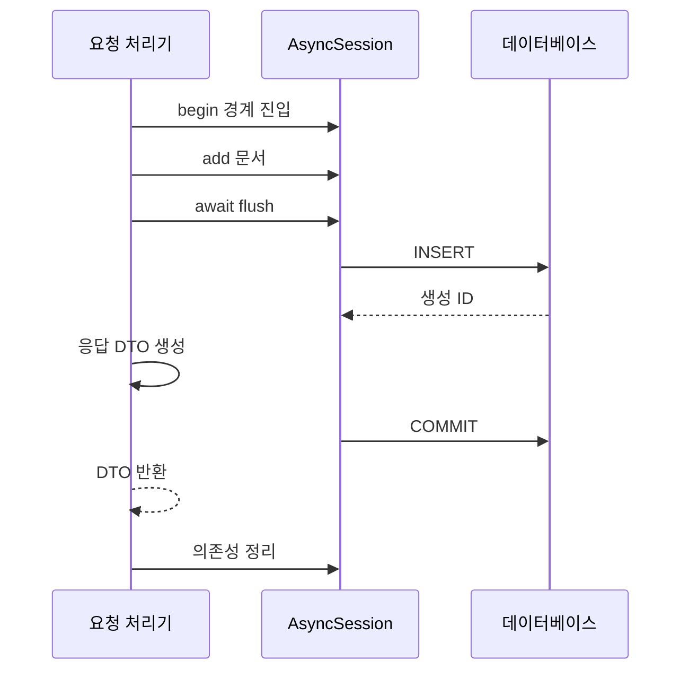

## 학습 목표

이 장의 핵심은 `await session.execute()`라는 문법이 아니다. 요청마다 세션과 트랜잭션을 어떻게 소유하고 종료할지, 연결 풀이 꽉 찼을 때 어디에서 대기하는지, 실패한 업무를 어떻게 되돌릴지 설명하는 것이다. Knowledge Hub의 문서 등록 API를 비동기 DB로 구현하고 유일성 충돌, 동시 접근, 마이그레이션의 경계를 확인한다.

문서 생성 API가 평소에는 빠르다가 AI 요청이 늘면 느려졌다고 하자. 요청 처리기는 문서를 SELECT한 뒤 같은 세션을 유지한 채 외부 모델 응답을 기다린다. 이벤트 루프는 다른 요청을 실행할 수 있지만 DB 연결은 계속 점유될 수 있다. 비동기 서버가 잘 스케줄링되는 것과 DB 자원을 효율적으로 쓰는 것은 별개다. 이 장에서는 이 차이를 실행 순서와 자원 수명으로 분석한다.

## 11.1 동기 DB 드라이버와 비동기 DB 드라이버

드라이버는 SQL을 DB 프로토콜로 보내고 응답을 받는 역할을 한다. 동기 드라이버의 호출은 결과를 받기까지 호출 스레드를 기다리게 한다. 비동기 드라이버는 I/O 대기 중 제어권을 이벤트 루프에 돌려줄 수 있다. ORM 메서드에 `async`를 붙이는 것만으로 동기 드라이버가 비동기 드라이버로 바뀌지는 않는다.

FastAPI의 `def` 엔드포인트 안에서 동기 DB를 쓰는 설계도 가능하다. FastAPI가 엔드포인트를 스레드 풀에서 실행하고 해당 스레드가 DB 응답을 기다린다. 반면 `async def` 안에서 동기 SQL을 직접 실행하면 이벤트 루프를 막을 수 있다. 서비스 헬퍼가 `def`라는 이유로 자동 스레드 풀 이동이 일어나지 않는다. 호출 경로 전체를 확인한다.

PostgreSQL에서는 이 장에 `asyncpg`를 사용한다. SQLite의 `aiosqlite`는 학습용 로컬 실행을 편하게 하지만 그 구현과 동시 쓰기 특성은 PostgreSQL과 다르다. SQLite 예제의 성공으로 PostgreSQL에서 같은 처리량이나 락 동작을 기대하지 않는다. 비동기가 DB의 SQL 실행 자체를 CPU 병렬화하는 것도 아니다. 서버는 기다리는 동안 다른 일을 할 수 있고 DB의 실행 용량은 별도 제한을 갖는다.

## 11.2 AsyncEngine과 AsyncSession

`create_async_engine()`은 비동기 드라이버를 사용하는 엔진을 만들고 `async_sessionmaker()`는 설정된 세션 팩터리를 만든다. Engine과 팩터리는 프로세스에서 재사용하되 AsyncSession은 짧은 작업 단위로 만든다. 세션은 진행 중인 트랜잭션, ORM 객체, 변경 기록을 가진 가변 객체다. 작업을 실행하는 Task마다 세션을 따로 소유하는 원칙은 [SQLAlchemy 비동기 안내](https://docs.sqlalchemy.org/en/20/orm/extensions/asyncio.html)에 명시되어 있다.

`session.add()`는 객체 상태를 바꾸는 로컬 작업이므로 await하지 않는다. SQL이 나가는 `execute`, `flush`, `commit`, `rollback`, `refresh` 등은 await 대상이다. `AsyncSession`을 쓴다는 이유로 모든 속성 접근이 await 가능한 것은 아니다. 관계를 읽는 일반 Python 표현에서 숨은 조회가 일어나면 비동기 I/O의 명시적 경계를 벗어나 오류가 생길 수 있다.

대응 방법은 필요한 관계를 쿼리에서 미리 로딩하고, 응답 DTO를 세션이 살아 있는 범위에서 만드는 것이다. `expire_on_commit=False`는 commit 후 로딩한 일반 속성을 재조회 없이 쓰는 데 도움이 된다. 이것이 모든 관계를 로딩하거나 객체를 영원히 최신 상태로 유지한다는 뜻은 아니다. 미로딩 관계, DB가 변경한 값, 동시 요청의 변경은 별도로 다룬다.

Engine은 앱 종료 시 `await engine.dispose()`로 정리한다. 이벤트 루프가 닫힌 뒤 가비지 컬렉션에 맡기면 비동기 연결 정리에 필요한 await를 실행하기 어렵다. 객체 생성과 종료를 lifespan에 두면 테스트와 서버 종료에서도 자원의 소유자를 찾기 쉽다.

## 11.3 PostgreSQL 비동기 연결: 완전 실행 실습

새 디렉터리에 다음 `async_db_lab.py`를 저장한다. 기본 URL은 SQLite 파일 DB이므로 별도 서비스 없이 실행된다. PostgreSQL로 전환할 때는 전용 실습 DB에 접속하고 테이블을 Alembic으로 만든다. 이 예제는 DB 내용을 자동으로 삭제하지 않는다.

```powershell
python -m pip install "fastapi>=0.121,<1" "uvicorn[standard]" "sqlalchemy>=2.0,<3" aiosqlite asyncpg alembic
python -m uvicorn async_db_lab:app --reload
```

완전 실행 예제, `async_db_lab.py`:

```python
import os
from contextlib import asynccontextmanager
from typing import Annotated
from fastapi import Depends, FastAPI, HTTPException, Request
from pydantic import BaseModel, ConfigDict, Field
from sqlalchemy import String, select
from sqlalchemy.exc import IntegrityError
from sqlalchemy.ext.asyncio import (
    AsyncSession, async_sessionmaker, create_async_engine,
)
from sqlalchemy.orm import DeclarativeBase, Mapped, mapped_column

class Base(DeclarativeBase):
    pass

class Document(Base):
    __tablename__ = "documents"
    id: Mapped[int] = mapped_column(primary_key=True)
    title: Mapped[str] = mapped_column(String(200), unique=True)

class DocumentCreate(BaseModel):
    title: str = Field(min_length=1, max_length=200)

class DocumentResponse(BaseModel):
    model_config = ConfigDict(from_attributes=True)
    id: int
    title: str

@asynccontextmanager
async def lifespan(app: FastAPI):
    url = os.getenv("HUB_DATABASE_URL", "sqlite+aiosqlite:///./hub_lab.db")
    options = {}
    if url.startswith("postgresql+"):
        options = dict(pool_size=5, max_overflow=2, pool_timeout=3)
    engine = create_async_engine(url, pool_pre_ping=True, **options)
    app.state.sessions = async_sessionmaker(
        engine, expire_on_commit=False
    )
    try:
        if url.startswith("sqlite+"):
            async with engine.begin() as connection:
                await connection.run_sync(Base.metadata.create_all)
        yield
    finally:
        await engine.dispose()

app = FastAPI(title="Knowledge Hub DB Lab", lifespan=lifespan)

async def get_session(request: Request):
    async with request.app.state.sessions() as session:
        yield session

SessionDependency = Annotated[
    AsyncSession, Depends(get_session, scope="function")
]

@app.post("/documents", response_model=DocumentResponse, status_code=201)
async def create_document(body: DocumentCreate, session: SessionDependency):
    title = body.title.strip()
    if not title:
        raise HTTPException(422, "제목은 공백만으로 만들 수 없습니다")
    try:
        async with session.begin():
            document = Document(title=title)
            session.add(document)
            await session.flush()
            result = DocumentResponse.model_validate(document)
        return result
    except IntegrityError as error:
        # 이 최소 모델의 입력 경로에서는 title 유일성 충돌로 한정한다.
        raise HTTPException(409, "이미 등록한 제목입니다") from error

@app.get("/documents/{document_id}", response_model=DocumentResponse)
async def read_document(document_id: int, session: SessionDependency):
    document = await session.get(Document, document_id)
    if document is None:
        raise HTTPException(404, "문서가 없습니다")
    return DocumentResponse.model_validate(document)

@app.get("/documents", response_model=list[DocumentResponse])
async def list_documents(session: SessionDependency):
    statement = select(Document).order_by(Document.id).limit(100)
    documents = (await session.scalars(statement)).all()
    return [DocumentResponse.model_validate(d) for d in documents]
```

`POST /documents`에 `{"title":"비동기 DB"}`를 보내면 201이다. 같은 제목을 다시 보내면 409이며 첫 문서는 남는다. 목록은 ID 순서로 최대 100개를 반환한다. 이것은 간단한 제한이지 페이지네이션의 완성 구현은 아니다. 운영에서는 페이지 크기, 다음 커서, 권한 조건을 추가한다.

PostgreSQL URL 형식은 `postgresql+asyncpg://사용자:비밀번호@호스트:5432/데이터베이스`다. 실제 비밀값은 코드에 저장하지 않고 실행 환경이나 비밀 관리 도구로 전달한다. 비밀번호에 특수 문자가 있으면 URL 인코딩이 필요하며, 운영 설정은 URL 문자열 조립보다 `URL.create()`를 고려할 수 있다. 전체 URL을 로그에 출력하지 않는다. PostgreSQL 모드에서는 아래 11.9절의 마이그레이션을 실행한 뒤 API를 시작한다.

이 예제의 `scope="function"`은 FastAPI 0.121 이상에서 사용하는 의존성 정리 범위다. 엔드포인트가 DTO를 반환한 뒤 응답 전송 전에 세션 정리를 마친다. 데이터를 이미 DTO로 복사했기 때문에 세션을 닫아도 응답에 추가 DB 조회가 필요하지 않다. 실제 서비스에서는 DB 연결과 수십 초 스트림 응답의 수명을 분리한다.

운영 모델에는 여러 제약이 생기므로 모든 IntegrityError를 제목 중복이라고 번역해서는 안 된다. 사용한 드라이버의 오류 정보와 제약 이름을 확인해 기대한 유일성 오류만 409로 매핑하고, 다른 무결성 오류는 내부 오류로 기록한다. 오류 문자열에 사용자 데이터가 섞일 수 있어 그대로 응답에 넣지 않는다.

## 11.4 DB 커넥션 풀의 동작 원리

요청이 세션을 생성했다고 곧바로 연결을 차지하는 것은 아니다. DB 작업이 필요할 때 풀이 연결을 빌려 주고 트랜잭션 종료와 세션 정리 과정에서 반환된다. 풀에 여유가 없으면 요청은 checkout을 기다린다. 이것은 DB 쿼리 실행 시간과 다른 대기다.

PostgreSQL 예제의 `pool_size=5`, `max_overflow=2`는 한 프로세스에서 최대 7개 연결을 사용하는 구성 예시다. 워커가 4개면 이론적 앱 연결 상한은 28개이며 다른 앱, 배치, 마이그레이션 연결은 별도다. 실제 DB가 허용하는 수와 운영 예약 연결을 빼고 예산을 정해야 한다. 이 숫자는 성능 권장값이나 실측 결과가 아니다.

`pool_timeout=3`은 연결을 얻기 위한 대기 제한이다. 쿼리가 30초 실행되는 것을 3초에 끊는 설정은 아니다. DB 문장 timeout, 락 대기 timeout, HTTP 요청 deadline은 각각 적용 지점이 다르다. `pool_pre_ping=True`는 대여 때 끊어진 연결을 확인하는 데 도움이 되지만 실행 중 끊김과 모든 네트워크 실패를 예방하지는 않는다.

자주 보이는 오해는 풀을 늘리면 언제나 빨라진다는 것이다. DB CPU와 디스크가 이미 포화 상태라면 연결을 더 열어 실행 중인 쿼리 수만 늘리고 지연을 키울 수 있다. 풀 대기, DB 실행 시간, 사용 연결 수, 요청 처리량을 함께 보고 결정한다. 짧은 읽기 API에 대한 이상적인 생각 실험에서 평균 연결 점유가 50밀리초이고 처리량이 초당 100개라면 평균 동시 점유는 약 5개다. 이는 용량 모델의 가정이지 실측이나 피크 상한이 아니다. 긴 꼬리와 락 대기가 있으면 더 많은 여유 또는 요청 제한이 필요하다.

## 11.5 트랜잭션 생명주기

트랜잭션은 함께 성공하거나 함께 실패해야 하는 DB 변경의 경계다. 문서와 감사 로그가 둘 다 저장되어야 한다면 같은 세션의 같은 트랜잭션에서 수행한다. 트랜잭션을 라우터 시작부터 끝까지 무조건 유지하는 방식은 단순하지만 외부 요청과 스트리밍까지 포함하면 연결과 락 점유가 길어진다.

문서 등록 실습의 순서는 다음과 같다.



성공 응답은 commit이 성공한 뒤에 반환한다. yield 의존성의 정리 구간에서 뒤늦게 commit하는 설계는 응답을 언제 전송하는지에 따라 “성공을 보낸 뒤 commit 실패” 문제를 만들 수 있다. 업무의 commit 책임을 요청 처리기의 명시적 트랜잭션 블록이나 서비스의 작업 단위 경계에 두는 편이 읽기 쉽다.

읽기 SELECT도 보통 세션에서 트랜잭션을 시작한다. 읽기니까 연결을 전혀 유지하지 않는다고 가정하지 않는다. 인증 의존성이 동일 세션으로 먼저 SELECT했다면 이미 autobegin 상태일 수 있다. 그 뒤 `session.begin()`을 새로 호출하면 “이미 트랜잭션이 시작되었다”는 오류가 날 수 있다. 새 begin을 무조건 추가하기보다 한 업무의 소유자를 정하고 공통 경계 안에서 인증과 변경을 수행하거나 별도 읽기 세션을 쓰는 정책을 정한다.

외부 모델 호출 뒤 결과를 저장하려면 DB에서 필요한 값을 짧게 읽어 DTO로 복사하고 트랜잭션을 끝낸 뒤 모델을 호출할 수 있다. 결과 저장 시 문서 버전이 여전히 같은지 검사해야 한다. 트랜잭션을 일찍 끝내면 자원 점유는 줄지만 읽은 값이 낡을 수 있다는 대가가 있다. 이 대가는 버전 비교와 충돌 정책으로 다룬다.

## 11.6 commit, flush, rollback, refresh

| 연산 | 주된 역할 | 흔한 오해 |
|---|---|---|
| `flush()` | 대기 중인 변경을 SQL로 실행 | 다른 요청에도 영구 저장되었다 |
| `commit()` | 트랜잭션 확정; 필요한 flush 포함 | 이후 모든 객체가 항상 최신이다 |
| `rollback()` | 트랜잭션 변경 취소 및 세션 오류 상태 정리 | 이미 발송한 이메일도 취소된다 |
| `refresh(obj)` | DB에서 지정 객체 값을 다시 조회 | 저장을 대신 수행한다 |

flush 후 생성 ID를 얻어 자식 행의 외래 키로 사용할 수 있다. 하지만 그 뒤 오류가 나서 rollback하면 삽입은 취소된다. PostgreSQL 시퀀스로 발급한 번호는 rollback되어도 번호 간격이 남을 수 있다. ID가 연속되지 않는다고 데이터 손실로 단정해서는 안 된다.

DB 기본값이나 트리거 결과가 필요하면 반환 기능으로 로딩되었는지 확인하고 필요할 때 refresh한다. 습관적으로 INSERT 후 commit 후 refresh를 모두 호출하면 불필요한 조회가 추가될 수 있다. 먼저 응답에 어떤 값이 필요한지 정하고 해당 방언과 모델에서 어떻게 값이 로딩되는지 확인한다.

flush 실패 뒤 같은 세션을 계속 사용하려면 rollback으로 오류 상태를 정리해야 한다. 예제의 `session.begin()`은 예외가 블록 밖으로 나갈 때 rollback한다. 오류를 블록 내부에서 잡고 성공처럼 계속 진행하면 경계가 실패를 볼 수 없어 처리가 꼬일 수 있다. 실패를 변환하더라도 원래 예외를 경계 밖으로 전파하거나 명확히 rollback한다.

rollback은 DB 트랜잭션에만 작용한다. 이미 실행한 외부 결제, 이메일 발송, Redis 갱신은 되돌리지 못한다. DB 변경과 큐 전달을 함께 보장해야 하면 같은 트랜잭션으로 outbox 행을 저장하고 별도 전달기가 처리하는 설계가 필요하다. 두 시스템의 원자성을 단순 try/except로 만들 수는 없다.

## 11.7 동시 요청과 세션 공유 문제

한 요청에서 `asyncio.gather()`로 두 SELECT를 실행하면 동시에 대기할 수 있을 것 같지만 같은 AsyncSession을 동시에 사용해서는 안 된다. 하나의 가변 트랜잭션 상태를 두 Task가 읽고 바꾸게 된다. 한 Task가 rollback하는 동안 다른 Task가 flush하거나 연결을 얻을 수도 있다. 공유 세션을 락으로 감싸면 동시 실행 이점이 사라지고 소유권도 불명확해진다.

기존 파일과 별개의 개념 예제, 세션 팩터리를 매개변수로 받는 동시 조회 함수:

```python
import asyncio
from sqlalchemy.ext.asyncio import async_sessionmaker, AsyncSession
from async_db_lab import Document

async def lookup(
    factory: async_sessionmaker[AsyncSession], document_id: int
) -> str | None:
    async with factory() as session:
        document = await session.get(Document, document_id)
        return document.title if document is not None else None

async def lookup_many(
    factory: async_sessionmaker[AsyncSession], ids: list[int]
):
    return await asyncio.gather(*(lookup(factory, value) for value in ids))
```

각 Task가 별도 세션을 소유하므로 공유 문제는 줄지만 입력 ID가 10만 개면 Task와 연결 대기가 폭증한다. 배치 쿼리 `WHERE id IN (...)`를 먼저 고려하고, 병렬 작업이 필요하면 제한된 배치나 Semaphore로 유입량을 줄인다. 여러 세션을 사용한 변경은 하나의 원자적 트랜잭션이 아니므로 함께 성공해야 하는 변경을 이 방식으로 분리하지 않는다.

또 다른 문제는 요청이 끝난 뒤 BackgroundTasks에 세션을 넘기는 것이다. 그 시점에는 의존성이 닫았거나 요청 트랜잭션이 끝났을 수 있다. 작업에는 문서 ID와 같은 값만 전달하고 작업 실행 시 새 세션을 만든다. 장기 작업의 수명과 HTTP 요청의 수명은 다르다.

## 11.8 DB 락, 격리 수준, 데드락

비동기 드라이버를 써도 같은 행의 변경은 DB 규칙에 따라 기다린다. asyncio의 락과 DB 행 락은 보호 범위가 다르다. 프로세스 내부 `asyncio.Lock`은 다른 워커와 다른 서버의 변경을 막지 못한다. 잔여 크레딧 차감이나 문서 버전 갱신은 DB의 조건부 UPDATE, 행 락, 제약으로 보호한다.

Read Committed에서는 하나의 트랜잭션 안에서도 다음 SELECT가 새로운 커밋을 볼 수 있다. 더 강한 격리는 일관성을 강화하지만 충돌 실패와 재시도 비용을 고려해야 한다. PostgreSQL의 MVCC와 격리 규칙은 [공식 격리 문서](https://www.postgresql.org/docs/current/transaction-iso.html)를 참고한다. 격리 수준의 이름만으로 모든 DB의 동작을 같다고 가정하지 않는다.

Knowledge Hub의 크레딧을 `SELECT balance`, Python에서 빼기, UPDATE 순서로 처리하면 두 요청이 같은 잔액을 읽어 갱신을 잃을 수 있다. 가능하면 `UPDATE ... SET balance = balance - :cost WHERE balance >= :cost`처럼 조건과 변경을 한 문장으로 묶고 영향받은 행 수를 검사한다. 여러 행의 업무 규칙을 검사해야 한다면 `SELECT FOR UPDATE`와 트랜잭션 경계를 검토한다.

개념 예제, SQL의 원자적 차감 형태다. 이 표는 실습 모델에 없으며 예제는 크레딧 테이블을 별도로 설계할 때의 쿼리다.

```sql
UPDATE credits
SET balance = balance - :cost
WHERE user_id = :user_id AND balance >= :cost;
```

사용자 입력으로 SQL 문자열을 직접 조립하지 않고 SQLAlchemy의 바인드 파라미터로 값을 전달한다. 원자적 차감은 유일한 사용자 행, 양수 cost 검증, 결과 행 수 해석 같은 전제와 함께 적용한다.

데드락은 A가 행 1을 잡고 행 2를 기다리며 B가 행 2를 잡고 행 1을 기다리는 순환 대기다. 업무가 가능하면 모든 경로에서 같은 순서로 행을 잠근다. 트랜잭션을 짧게 유지하고 외부 호출을 락 안에서 수행하지 않는다. DB가 피해 트랜잭션을 중단하면 제한된 재시도를 할 수 있지만 읽기부터 다시 시작해야 한다. 실패한 마지막 SQL만 재실행하면 새 상태에 대한 판단이 빠진다.

재시도에는 최대 횟수와 총 시간 예산, 지터가 필요하다. 이메일이나 결제 같은 부작용을 트랜잭션 재시도 함수 안에 넣으면 중복 실행될 수 있다. 멱등성 키와 outbox를 설계하고, 재시도 가능한 DB 오류와 입력 오류를 분리한다. 취소 예외를 무작정 잡아 재시도하면 서버 종료와 요청 deadline을 무시할 수 있다.

## 11.9 Alembic을 이용한 스키마 마이그레이션

모델을 고쳐도 기존 테이블이 자동 변경되지는 않는다. `create_all()`은 없는 테이블의 초기 생성에 적합하며 컬럼 변경, 데이터 이동, 롤링 배포 호환성을 관리하지 않는다. Alembic은 변경 이력을 revision 파일로 남기고 DB를 지정된 이력으로 이동시킨다.

PostgreSQL을 위한 절차는 전용 실습 DB URL을 환경변수에 준비하고 다음 명령으로 시작한다. `alembic init`은 새 디렉터리에서 한 번만 실행한다.

```powershell
python -m alembic init -t async migrations
python -m alembic revision --autogenerate -m "create documents"
python -m alembic upgrade head
```

위 두 번째 명령 전에 생성된 `migrations/env.py`를 다음 코드로 교체한다. DB 비밀번호를 `alembic.ini`에 기록할 필요가 없다. API를 실행하기 전에 마이그레이션을 단일 관리 작업으로 수행한다. 여러 워커가 시작할 때 동시에 스키마를 변경하지 않는다.

기존 생성 파일 변경, `migrations/env.py`:

```python
import asyncio
import os
from alembic import context
from sqlalchemy import pool
from sqlalchemy.ext.asyncio import create_async_engine
from async_db_lab import Base

target_metadata = Base.metadata

def database_url() -> str:
    return os.environ["HUB_DATABASE_URL"]

def run_migrations_offline() -> None:
    context.configure(
        url=database_url(), target_metadata=target_metadata,
        literal_binds=True, dialect_opts={"paramstyle": "named"},
        compare_type=True,
    )
    with context.begin_transaction():
        context.run_migrations()

def run_sync_migrations(connection) -> None:
    context.configure(
        connection=connection, target_metadata=target_metadata,
        compare_type=True,
    )
    with context.begin_transaction():
        context.run_migrations()

async def run_online() -> None:
    engine = create_async_engine(database_url(), poolclass=pool.NullPool)
    try:
        async with engine.connect() as connection:
            await connection.run_sync(run_sync_migrations)
    finally:
        await engine.dispose()

if context.is_offline_mode():
    run_migrations_offline()
else:
    asyncio.run(run_online())
```

자동 생성 결과는 검토할 초안이다. 컬럼 이름 변경을 삭제와 추가로 판단하면 데이터 손실을 일으킬 수 있다. 서버 기본값, 제약 이름, 자료형 변환, 인덱스 생성의 락 비용도 검토한다. 자동 감지의 범위는 [Alembic autogenerate 문서](https://alembic.sqlalchemy.org/en/latest/autogenerate.html)에서 확인한다.

운영 변경에서는 새 컬럼 추가, 새 코드 배포, 데이터 채우기, 구 코드 제거, 구 컬럼 제거처럼 확장 후 축소 절차를 사용할 수 있다. 롤링 배포 중 구 코드와 신 코드가 같은 DB를 이용하므로 중간 스키마도 양쪽과 호환되어야 한다. downgrade 파일이 있다고 데이터를 완전히 되돌릴 수 있는 것도 아니다. 파괴적 변경 전에는 복구 정책과 실제 복원 가능성을 확인한다.

## 실무 적용과 실패 분석

풀 고갈을 의심할 때는 앱의 연결 대기 시간과 DB의 실행 중 세션을 함께 본다. 짧은 SQL이 많은데 연결 대기가 길면 세션 정리 누락이나 긴 트랜잭션을 찾는다. DB에서 락 대기가 길면 풀 숫자보다 업무 순서와 인덱스를 먼저 검토한다. 서버 CPU가 높으면 ORM 객체 생성, 직렬화, 잘못된 동기 호출도 후보가 된다.

운영 요청에는 총 deadline이 있고 그 안에서 풀 대기와 SQL 실행이 끝나야 한다. 클라이언트가 떠났다는 이유만으로 이미 commit된 DB 변경이 취소되지 않는다. 반대로 commit 응답 중 네트워크가 끊기면 클라이언트는 성공 여부를 확신하지 못할 수 있다. 쓰기 API의 멱등성 키와 결과 조회 경로는 이 불확실성을 처리하는 도구다.

최소 실습은 인증, 접근 제어, PostgreSQL 통합 실행, 장애 재시도 자동화까지 포함한 운영 서비스가 아니다. 여기서 검증하는 것은 세션 소유권, commit 전후 흐름, 유일성 충돌 처리다. 운영 전환 시 실제 DB에서 제약 이름, timeout, 격리, 네트워크 단절, 마이그레이션 시간을 추가 검증한다.

## 확인 문제와 해설

1. AsyncSession을 `gather()` 안의 두 작업에 공유하면 왜 안 되는가? **해설:** 세션은 하나의 가변 트랜잭션 상태다. 비동기 안전한 공유 연결 컨테이너가 아니다. 별도 세션 또는 하나의 배치 쿼리를 선택한다.
2. `flush()` 성공 뒤 201을 바로 보내도 되는가? **해설:** 아직 commit이 실패할 수 있다. 응답값은 미리 만들 수 있지만 성공 응답은 commit 완료 뒤 반환한다.
3. 풀 상한을 20으로 두고 워커를 4개 쓰면 DB 연결 상한은 20인가? **해설:** 일반적으로 워커마다 풀이 있어 최대 앱 연결 예산은 80이 된다. DB의 다른 이용자도 포함해야 한다.
4. 실습 과제: 같은 제목으로 두 요청을 동시에 보내라. **평가 기준:** 하나만 저장되고 나머지는 409이며, 충돌 뒤 새로운 정상 요청을 처리할 수 있어야 한다. SQLite와 PostgreSQL의 오류 코드를 혼동하지 않는다.
5. 설계 과제: 문서 읽기와 LLM 호출 사이에서 트랜잭션을 끝내는 흐름을 그려라. **평가 기준:** 연결 반환 위치, 문서 변경 감지 방식, 결과 저장의 별도 트랜잭션, 실패한 외부 호출의 처리 위치가 명확하다.

## 요약과 다음 장

비동기 DB의 안전성은 자원 소유권에서 시작한다. Engine은 프로세스 수명, 세션과 트랜잭션은 업무 수명으로 관리하고 숨은 I/O를 응답 직렬화에 남기지 않는다. 연결 대기, SQL 실행, 락 대기를 구분하며 스키마 변경을 이력으로 관리한다. 다음 장은 DB의 반복 읽기를 줄이기 위한 Redis 캐시를 도입하고 정합성의 대가를 분석한다.

## 공식 참고자료

- [SQLAlchemy — Asyncio](https://docs.sqlalchemy.org/en/20/orm/extensions/asyncio.html): 비동기 엔진, 세션, 로딩과 동시 Task 사용.
- [SQLAlchemy — Connection Pooling](https://docs.sqlalchemy.org/en/20/core/pooling.html): 풀 설정과 checkout.
- [PostgreSQL — Transaction Isolation](https://www.postgresql.org/docs/current/transaction-iso.html): 격리와 동시 갱신의 DB 규칙.
- [Alembic — Autogenerate](https://alembic.sqlalchemy.org/en/latest/autogenerate.html): 자동 생성 범위와 검토 사항.
- [FastAPI — Dependencies with yield](https://fastapi.tiangolo.com/tutorial/dependencies/dependencies-with-yield/): 의존성 정리 범위.

<!-- book-navigation -->

---

[전체 목차](../index.md) · [← 10장 SQLAlchemy와 ORM](../10-sqlalchemy-orm/chapter.md) · [12장 Redis와 캐싱 전략 →](../12-redis-cache/chapter.md)
