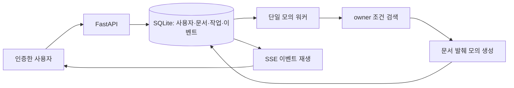

## 학습 목표와 프로젝트 범위

사용자 인증, 문서 권한, 질의 접수, 작업 상태, 근거, SSE, 사용량 원장을 하나의 작은 서비스로 연결한다. 이 장의 `project`는 유료 API 없이 실행하는 **로컬 최소판**이다. 실제 임베딩 대신 단어 검색, 실제 LLM 대신 원문 발췌, LangGraph 대신 고정 파이프라인, PostgreSQL 대신 SQLite를 사용한다. 운영 확장판의 설계도 함께 설명하지만 구현되지 않은 기능이 최소판에 있다고 주장하지 않는다.

Knowledge Hub 사용자는 UTF-8 문서를 올리고 질문한다. 서버는 사용자가 소유한 문서만 검색하고 job을 저장한다. 워커는 답변을 만들고 사용량을 정산한 뒤 이벤트를 저장한다. 클라이언트는 상태를 조회하거나 SSE로 이벤트를 재생한다. 이 작은 수직 흐름을 실제로 확인하면 저장소와 공급자를 교체할 때 유지해야 할 경계가 보인다.

프로젝트는 한 개 프로세스에서만 동작하도록 설계했다. 사용자·문서·작업·이벤트·모의 예산은 SQLite 파일에 남는다. 시작할 때 running을 queued로 되돌리는 복구 규칙은 외부 부작용 없는 모의 파이프라인에 한정한다. 멀티워커에서 이 규칙을 사용하면 다른 워커가 수행 중인 작업을 되돌릴 수 있으므로 `--workers`를 추가하면 안 된다. 분산 운영판은 lease와 fencing, 외부 멱등성을 별도로 구현해야 한다.

## 29.1 요구사항 분석 및 아키텍처 설계

기능 요구사항을 먼저 실행 가능한 계약으로 정한다. `POST /users`는 계정을 만들고 `POST /token`은 15분 JWT를 발급한다. `POST /documents`는 text/plain UTF-8 본문을 최대 64 KiB까지 읽는다. `POST /jobs`는 질문과 Idempotency-Key를 받아 202를 반환한다. `GET /jobs/{id}`와 `/events`는 자신의 작업에만 접근한다. `GET /me`는 모의 문자 단위 사용량과 예약량을 보여 준다.

보안 요구사항은 동작으로 확인한다. bob의 질문을 처리할 때 alice의 문서를 모델에 전달하지 않는다. job ID를 알아도 다른 소유자가 조회하면 404다. JWT는 고정 algorithm, issuer, audience, exp, nbf와 필수 claim을 검증한다. 비밀 키는 코드에 넣지 않고 환경변수로 제공한다. 생성 텍스트는 API에서 문자열 데이터이며 프런트엔드는 HTML/Markdown 렌더링에 필요한 escaping과 링크 정책을 적용해야 한다.

비기능 요구사항도 작은 상한으로 표현한다. 사용자별 문서는 최대 30개, 활성 작업은 최대 5개, 질문은 최대 1,200자, 모의 출력은 최대 800자다. 모의 예산 100,000은 실제 돈이나 모델 토큰이 아니다. 모든 질문의 원문을 operational log에 남기는 기능은 만들지 않는다. 실제 서비스에서는 비용, 개인정보 보존, 감사, 탈퇴·삭제, 계정 복구를 별도 요구로 정해야 한다.

최소판 실행 경로는 다음과 같다.



API 접수와 긴 작업의 완료를 나눈 이유는 타임아웃과 재접속을 단순하게 만들기 위해서다. 사용자가 접수 응답을 잃고 다시 보내면 같은 사용자·같은 key·같은 질문은 기존 job을 돌려준다. 같은 key로 다른 질문을 보내면 409다. key를 전역으로 공유하지 않고 소유자와 함께 unique로 묶어 사용자 간 충돌을 막는다.

## 29.2 FastAPI 프로젝트 구조 설계

프로젝트 파일은 이 장의 `project/`에 있다. 장별 실습은 독립 예제이므로 앞 장의 파일을 순서대로 합칠 필요가 없다.

```text
project/
  README.md
  requirements.txt
  Dockerfile
  compose.yaml
  .dockerignore
  load.js
  app/
    __init__.py
    main.py
    security.py
    db.py
    pipeline.py
  tests/
    test_api.py
```

`main.py`는 라우팅, 요청 검증, 인가, 접수를 연결한다. `security.py`는 비밀번호와 JWT 형식을 관리한다. `db.py`는 각 작업이 자신의 SQLite connection을 갖도록 실행한다. `pipeline.py`는 claim, owner 검색, 모의 생성, 원장 정산, 공개 이벤트 저장을 수행한다. 기능 규모가 작으므로 repository와 service 파일을 과도하게 나누지 않았다. 실제 문서 공유와 조직 정책이 늘면 도메인별 서비스·저장소 계층으로 분리한다.

SQLite 호출은 `asyncio.to_thread`로 실행하며 connection은 해당 동기 작업 내부에서 생성하고 닫는다. connection을 여러 Task나 스레드가 동시에 공유하지 않는다. 비동기 API라고 DB가 마법처럼 비동기 드라이버로 바뀌는 것은 아니다. 이 선택은 의존성을 줄인 작은 실습에 맞고 PostgreSQL 운영판에서는 AsyncEngine과 요청/작업별 AsyncSession으로 바꾼다. SQLAlchemy Session도 동시 Task 공유를 피해야 한다.

트랜잭션 경계는 기능 경계와 일치시킨다. 접수는 예산 예약과 job·queued event를 함께 저장한다. 완료는 상태·예약 해제·사용량 추가·sources/delta/done event를 함께 저장한다. 문서 개수 검사와 삽입도 같은 `BEGIN IMMEDIATE` 구간에서 수행한다. 작은 SQLite 단일판에서는 쓰기 직렬화가 단순성을 주지만 쓰기 처리량이 높은 플랫폼의 해법으로 일반화하면 안 된다.

## 29.3 PostgreSQL과 Redis 구성

운영 확장판에서는 PostgreSQL에 사용자, 조직 구성원, 문서 revision, ACL, chunk, job, usage ledger, tool operation, approval, outbox를 둔다. pgvector로 허용 청크를 검색하고 Redis에는 빠른 요청 제한·짧은 캐시·실시간 신호 또는 선택한 내구성 큐를 둔다. Redis를 최종 비용 원장의 유일한 저장소로 쓰는 것은 복구·감사 요구를 충족하는지 별도 검토가 필요하다.

아래는 **운영 확장판 개념 예제** PostgreSQL 핵심 제약이다. 이 프로젝트가 실행하는 스키마가 아니다. 다른 테이블과 외래키는 실제 서비스의 조직 모델에 맞춰 설계한다.

```sql
CREATE TABLE jobs (
  id uuid PRIMARY KEY,
  owner_id bigint NOT NULL,
  idempotency_key text NOT NULL,
  payload_hash text NOT NULL,
  status text NOT NULL,
  lease_until timestamptz,
  lease_version bigint NOT NULL DEFAULT 0,
  created_at timestamptz NOT NULL DEFAULT now(),
  UNIQUE (owner_id, idempotency_key)
);
CREATE TABLE outbox (
  id uuid PRIMARY KEY,
  job_id uuid NOT NULL REFERENCES jobs(id),
  topic text NOT NULL,
  payload jsonb NOT NULL,
  published_at timestamptz
);
CREATE TABLE usage_ledger (
  job_id uuid NOT NULL REFERENCES jobs(id),
  attempt_id text NOT NULL,
  kind text NOT NULL,
  units bigint NOT NULL,
  PRIMARY KEY(job_id, attempt_id, kind)
);
```

접수 트랜잭션에서 job과 outbox를 함께 넣고 발행기가 미발행 이벤트를 큐로 보낸다. 큐 publish 성공 후 DB의 published_at을 기록하기 전에 죽으면 메시지가 다시 발행될 수 있다. 소비자는 job 상태와 operation ID를 기준으로 중복을 흡수한다. outbox는 DB와 큐 사이의 누락 창을 줄이고 unique·조건부 상태 전이는 중복 결과를 제어한다. 두 기능을 함께 설계한다.

Redis Streams를 선택한 경우 완료 DB commit 후 ACK하고 pending reclaim과 dead-letter 정책을 둔다. reclaim은 중복 실행 가능성을 갖기 때문에 exactly once를 주장하지 않는다. 큐와 pub/sub를 혼동하지 않는다. SSE 알림을 pub/sub로 보내더라도 재생 가능한 event 저장소를 별도로 유지한다. 현재 로컬판은 DB polling worker이므로 Redis 장애 시나리오를 구현했다고 볼 수 없다. [Redis Streams](https://redis.io/docs/latest/develop/data-types/streams/)

## 29.4 JWT 기반 사용자 인증

프로젝트는 비밀번호에 무작위 salt와 scrypt를 적용하고 비교에는 constant-time 비교 함수를 사용한다. 해싱은 `to_thread`로 보내 이벤트 루프 점유를 줄인다. 운영에서는 측정한 CPU·메모리 비용에 맞춰 해싱 파라미터와 로그인 동시성 제한을 정한다. 계정이 없을 때와 비밀번호가 틀릴 때의 처리 시간 차이, 로그인 rate limit, 비밀번호 재설정, MFA는 최소판의 구현 범위를 넘어 추가 보완이 필요하다.

JWT 발급 claim은 sub, iss, aud, iat, nbf, exp다. decode에는 `algorithms=["HS256"]`과 issuer/audience, 필수 claim 목록을 준다. 토큰 헤더의 algorithm을 그대로 신뢰하지 않는다. 검증한 sub는 숫자로 변환한 뒤 DB에 현재 사용자가 존재하는지 확인한다. 사용자를 삭제하거나 잠글 수 있는 운영판에서는 계정 상태와 토큰 철회·키 회전 정책도 확인한다. [PyJWT 검증 문서](https://pyjwt.readthedocs.io/en/stable/usage.html)

HS256 비밀 키는 최소 32자의 고엔트로피 값으로 제공한다. 문자 수는 강도를 자동 보장하지 않으므로 무작위 생성한다. 로컬 실행에서는 다음 명령으로 환경변수를 만든다. **실습 명령**이며 비밀 값을 파일에 하드코딩하지 않는다.

```powershell
python -m venv .venv
.\.venv\Scripts\python -m pip install -r requirements.txt
$env:HUB_JWT_SECRET = (& .\.venv\Scripts\python -c "import secrets; print(secrets.token_urlsafe(48))")
.\.venv\Scripts\python -m uvicorn app.main:create_app --factory --host 127.0.0.1 --port 8000
```

`project` 디렉터리에서 실행한다. secret가 없으면 애플리케이션 생성 시 명시적으로 실패한다. 기존 DB와 토큰을 유지해 다시 실행할 때는 같은 secret를 유지해야 한다. 새 키를 만들면 기존 토큰 검증이 실패한다. 운영 비밀 키는 secret manager나 배포 환경의 안전한 주입 방식을 사용한다. 로컬판은 refresh token과 OIDC 로그인까지 제공하지 않는다.

## 29.5 문서 업로드 및 임베딩 처리

최소판은 원본 파일 파서를 실행하지 않는다. `POST /documents?title=guide`의 raw text/plain 본문을 읽고 UTF-8을 검증한다. 스트림 누적 길이가 65,536바이트를 넘으면 413, 포맷이 다르면 415, 비어 있거나 잘못된 UTF-8이면 422다. JSON 문자열의 문자 수와 바이트 수가 다를 수 있어 업로드 제한은 바이트로 확인한다. 문서는 인증한 owner와 연결한다.

운영판은 원문 객체 저장 → document/revision/outbox 기록 → 파싱 워커 → 청킹 → 임베딩 → 인덱스 활성화로 구성한다. 각 단계는 revision과 모델 버전으로 멱등성을 갖고 삭제된 revision을 늦은 결과가 활성화하지 못하게 상태 조건을 확인한다. PDF·Office 파서는 API 프로세스에서 분리하고 실행 시간·메모리·페이지·압축 해제 크기를 제한한다.

최소판 검색은 `SELECT ... FROM documents WHERE owner=?`로 허용 문서를 먼저 읽고 단어 교집합을 계산한다. 생성기는 해당 문서의 짧은 부분만 발췌한다. 임베딩 벡터나 HNSW를 쓰는 것처럼 이름을 바꾸지 않았다. 실제 운영에서 pgvector로 교체할 때도 owner/tenant와 ACL 조건은 후보를 응용 계층에 전달하기 전 적용한다. 인덱스 내부 필터 동작과 허용 집합 검색 품질은 26장의 기준으로 검증한다.

## 29.6 LangGraph Agent 실행 API

최소판 워커는 고정된 retrieve → mock answer → settle 파이프라인이다. 선택적 도구 사용, LangGraph checkpoint, 승인 중단·재개를 구현한 Agent 엔진은 아니다. 대신 run 접수·권한·멱등성·이벤트 경계를 실행 가능한 형태로 제공하므로 그래프 엔진을 붙일 위치가 분명하다. `run_once`가 claim한 job을 LangGraph 입력으로 변환하고 최종 결과를 기존 완료 트랜잭션에 연결할 수 있다.

운영판에서는 그래프 입력에 question과 run ID, 허용 문서 범위를 전달하고 인증 토큰 원문은 상태에 저장하지 않는다. 노드가 사용할 도구는 서버가 인증 컨텍스트를 주입한다. thread ID와 run ID의 소유권을 job DB에 연결하고 체크포인트 조회·재개 API도 같은 권한 검증을 수행한다. 영속 checkpointer를 사용하되 체크포인트와 업무 DB 커밋 불일치를 복구할 재조정기를 둔다. [LangGraph Persistence](https://docs.langchain.com/oss/python/langgraph/persistence)

상태 변경 도구는 승인과 operation 원장 뒤에 실행한다. 승인 payload에는 tool, target, argument hash, run/step ID, 만료, 승인자를 기록한다. 승인 후 인자가 바뀌면 재승인이 필요하고 실행 직전에 권한을 다시 확인한다. interrupt 이전에 티켓 생성 같은 부작용을 넣으면 재개 시 중복될 수 있다. checkpointer가 있다는 이유로 외부 효과를 무조건 반복하지 않는다. [LangGraph Interrupts](https://docs.langchain.com/oss/python/langgraph/interrupts)

## 29.7 SSE 기반 실시간 응답

이 프로젝트의 SSE는 영속 이벤트 재생이다. 모의 생성 결과가 완료되면 sources, 여러 delta, done을 한 트랜잭션에 저장하고 구독자가 차례대로 받는다. 실제 공급자가 토큰을 만드는 즉시 네트워크로 전송하는 구현은 아니다. 단계별 저장과 Last-Event-ID 재생을 먼저 확인하도록 설계했다. 사용자가 작업 완료 후 연결해도 같은 이벤트를 받을 수 있다.

라우트는 스트림 응답을 만들기 전에 job 소유권을 확인한다. 없는 job과 다른 사용자 job은 404다. generator는 작업별 event ID보다 큰 항목을 순서대로 읽는다. 완료/error 이벤트를 보내면 연결을 종료한다. 대기 중 heartbeat를 보내고 연결 최대 수명은 30초다. 장기 작업이 남으면 reconnect 이벤트를 보내며 클라이언트는 인증을 갱신하고 마지막 ID로 이어 받을 수 있다.

`Last-Event-ID`는 작업 조회 권한을 대신하지 않는다. 다른 작업의 큰 ID를 보내면 일부 이벤트를 건너뛸 수 있으므로 클라이언트는 작업별 cursor를 관리한다. 서버는 event 조회 SQL에 job 조건을 반드시 포함한다. 오래된 cursor 보존 기간 정책과 snapshot 전환은 운영판에서 추가해야 한다. 이벤트 삭제 기능이 없는 최소판에서는 저장 공간을 오래 쓰는 시험에 적합하지 않다.

다음은 **실행 중인 로컬판을 호출하는 실습 명령**이다. 서버 실행 후 별도 터미널에서 수행한다. 이 책 제작 과정에서 네트워크 서버를 띄우거나 외부 모델을 호출한 것은 아니다.

```powershell
$root = 'http://127.0.0.1:8000'
$body = @{ username = 'alice'; password = 'local-password-12345' } | ConvertTo-Json
Invoke-RestMethod -Method Post -Uri "$root/users" -ContentType application/json -Body $body
$token = (Invoke-RestMethod -Method Post -Uri "$root/token" -ContentType application/json -Body $body).access_token
$headers = @{ Authorization = "Bearer $token" }
Invoke-RestMethod -Method Post -Uri "$root/documents?title=guide" -Headers $headers -ContentType 'text/plain; charset=utf-8' -Body 'FastAPI supports asynchronous API services.'
$jobHeaders = @{ Authorization = "Bearer $token"; 'Idempotency-Key' = 'demo-1' }
$job = Invoke-RestMethod -Method Post -Uri "$root/jobs" -Headers $jobHeaders -ContentType application/json -Body '{"question":"FastAPI"}'
Invoke-RestMethod -Uri "$root/jobs/$($job.id)" -Headers $headers
curl.exe -N -H "Authorization: Bearer $token" "$root/jobs/$($job.id)/events"
```

기대 결과는 다음과 같다. users는 201, token은 access_token, documents는 문서 ID, jobs는 202와 job ID를 반환한다. 상태는 queued 또는 이미 running/succeeded일 수 있으며, 최종 답변에는 문서 ID와 발췌가 포함된다. SSE에서 state, sources, delta, done을 확인한다. 재실행 때 username이 이미 존재하면 409이므로 새 이름을 사용하거나 등록 단계를 건너뛴다.

## 29.8 Agent 작업 상태 및 이력 저장

claim은 `BEGIN IMMEDIATE`에서 queued 행을 선택하고 running으로 바꾼다. SQLite가 쓰기를 직렬화하므로 작은 단일 워커에서 단순한 claim을 얻는다. PostgreSQL 운영판은 `FOR UPDATE SKIP LOCKED`와 짧은 lease를 검토할 수 있다. claim 트랜잭션을 유지한 채 모델 호출을 기다리지 않는다. DB 연결은 claim 후 반환하고 완료 때 새 트랜잭션을 연다.

최소판 worker Task는 lifespan에 소유자를 둔다. 종료 시 stop을 설정하고 잠시 완료를 기다린 뒤 timeout이면 취소한다. `CancelledError`는 삼키지 않으며 running과 예약을 남긴다. 다음 단일 프로세스 시작 시 running을 queued로 복구한다. 이 정책이 가능한 이유는 모의 생성에 외부 부작용과 실제 과금이 없고 마지막 완료 트랜잭션이 원자적이기 때문이다.

운영판에서는 시작 시 모든 running을 되돌리지 않는다. lease 만료와 워커 heartbeat, version을 확인하고 상태 전이에 fencing 조건을 사용한다. 워커가 실패한 시점에 따라 새로 실행, 체크포인트 재개, 외부 결과 조회, 사람 확인으로 나눈다. 최종 실패와 결과 불명 상태는 같지 않다. 운영자가 재처리할 때도 이전 attempt의 정산과 도구 실행 원장을 확인한다.

## 29.9 사용자별 실행량과 비용 추적

접수 때 `len(question)+800`을 예약한다. 같은 트랜잭션에서 사용자 행에 `used+reserved+reservation <= quota` 조건을 적용한다. 완료 때 실제 모의 문자량 `len(question)+len(answer)`를 더하고 예약을 해제한다. 모의 답변은 800자 이하라 예약 상한을 넘지 않는다. 실패 때는 외부 호출이 없으므로 예약을 전액 돌려준다. 이 수치를 실제 공급자 token과 통화 비용이라고 표시하지 않는다.

같은 Idempotency-Key의 replay는 예산을 다시 예약하지 않는다. 완료 상태 검사와 원장 정산은 한 트랜잭션에서 수행해 같은 job을 두 번 완료하려 해도 사용량이 두 번 더해지지 않는다. 사용자별 활성 작업 최대 5개도 접수 트랜잭션에서 검사한다. GET /me는 used, reserved, quota와 `usage_kind=mock_character_units`, `currency_cost=0`을 명시한다.

운영 비용 원장은 provider usage, 추정 usage, 가격 버전, attempt, 통화, 정산 상태를 분리한다. 타임아웃이 발생했다고 비용을 0으로 정산하지 않는다. 실제 생성이 완료되었으나 응답이 사라졌을 수 있기 때문이다. 사용자 화면에는 잠정 사용량과 최종 사용량을 구분하고 정정 이벤트를 남긴다. 모델 fallback과 재시도도 각각 비용을 발생시킬 수 있다.

## 29.10 Docker 기반 배포

project의 Dockerfile은 Python 3.12 기반으로 의존성을 설치하고 비특권 사용자로 실행한다. app만 복사하고 데이터 디렉터리 소유권을 부여한다. compose는 로컬 127.0.0.1:8000만 노출하며 named volume에 SQLite를 보존한다. secret는 실행 환경에서 필수로 받는다. 실습 파일이 제공되어 있지만 이 책 제작 과정에서 Docker build와 컨테이너 실행을 검증하지는 않았다.

**선택 실습 명령:** secret 환경변수를 먼저 설정한 뒤 project 디렉터리에서 `docker compose up --build`를 실행한다. 로컬판은 컨테이너 하나와 Uvicorn worker 하나만 사용한다. 데이터 볼륨을 무심코 제거하지 않으며 테스트 데이터의 삭제는 의도적인 별도 관리 작업으로 수행한다. 이미지와 의존성을 재현하려면 팀의 검증된 lockfile과 digest를 추가하는 것이 다음 단계다.

운영판 배포는 API, ingestion worker, Agent worker, outbox publisher, PostgreSQL, Redis, 객체 저장소, gateway로 분리한다. readiness는 의존성 준비와 모델 워밍업을 확인하고 liveness는 일시적인 공급자 장애 때문에 전체 인스턴스를 반복 재시작하지 않게 설계한다. graceful shutdown은 접수 중단, SSE drain, checkpoint 저장, lease 반납을 포함한다. schema migration은 각 API worker 시작 때 동시에 수행하지 않고 배포 단계의 한 작업으로 수행한다.

## 29.11 k6 부하 테스트 및 성능 개선

project의 `load.js`는 로컬 모의 서버에 초당 2건씩 30초 접수하는 교육용 arrival-rate 시나리오다. 유효한 HUB_TOKEN과 실행마다 새로운 RUN_ID가 필요하다. 각 요청은 202를 확인하고 상태를 잠시 polling해 succeeded를 확인한다. 최대 성능 측정이나 운영 SLO 검증 결과를 제공하는 파일은 아니다. 이미 사용량을 많이 쓴 계정이나 만료 토큰을 사용하면 테스트가 실패한다.

**선택 실습 명령**은 다음과 같다. 서버와 k6가 학습자의 컴퓨터에 준비되어 있을 때만 실행한다.

```powershell
$env:HUB_TOKEN = $token
$env:RUN_ID = [guid]::NewGuid().ToString('N')
k6 run load.js
```

최적화 전에는 queue wait와 완료 지연, SQLite 쓰기 대기, 문서 검색 시간, 활성 작업·거절율을 기록한다. 단어 검색은 사용자의 모든 문서를 읽으므로 문서량 증가에 따라 느려진다. 실제 검색 인덱스를 도입하고 claim·event 조회 인덱스를 확인한다. DB connection을 모델 생성 동안 잡고 있지 않은 구조를 유지한다. SSE buffering과 느린 클라이언트는 별도 스트림 harness로 확인한다. 현재 load.js는 live chunk 도착·구독자 backpressure를 검증하지 않는다.

모의 공급자의 sleep을 줄이면 완료율이 증가하겠지만 모델 최적화를 증명한 것은 아니다. 모의 모델은 서버와 작업 계약을 시험하고 실제 모델 시험은 품질·토큰 처리량·비용을 별도로 측정한다. 워커를 늘리기 전에 저장소 claim과 복구 정책을 분산 환경에 맞춰 변경해야 한다.

## 29.12 Prometheus와 Grafana 모니터링

최소판은 production metrics exporter와 Grafana 대시보드를 포함하지 않는다. 운영 확장판에서 접수 counter, 완료 counter, 단계별 duration histogram, 활성 작업 gauge, queue age, 예약 비용, SSE 연결·버퍼 크기, tool failure를 계측한다. user ID와 job ID를 label로 넣지 않는다. 높은 cardinality는 모니터링 시스템 자체를 느리게 만든다. 상세 추적은 request/run ID가 있는 구조화 로그 또는 trace에 둔다. [Prometheus instrumentation](https://prometheus.io/docs/practices/instrumentation/)

아래는 **개념 예제** 대시보드용 PromQL이다. 실제 exporter가 이 이름의 counter와 histogram을 노출하도록 구현해야 하며 현재 프로젝트에서 바로 실행할 수 있는 쿼리는 아니다.

```promql
sum(rate(hub_jobs_completed_total{status="succeeded"}[5m]))
sum(rate(hub_jobs_completed_total{status="failed"}[5m]))
histogram_quantile(0.95,
  sum by (le) (rate(hub_job_duration_seconds_bucket[5m])))
max(hub_oldest_queued_job_age_seconds)
```

대시보드는 API 상태와 생성 상태를 분리한다. 접수 HTTP 202가 계속 성공하더라도 queue age가 커지면 사용자는 답변을 받지 못한다. queue age와 완료율·실패율을 첫 화면에 둔다. DB pool 대기와 모델 TTFT, 재시도율을 함께 보면 병목 위치를 판단하기 쉽다. 경보는 지속 시간과 영향 범위를 갖고 연결된 runbook에 제한 감소, 공급자 확인, stuck job 조회, 데이터 정합성 점검을 기록한다. 실제 공급자 장애를 재현하지 않은 채 자동 failover가 안전하다고 단정하지 않는다.

## 검증된 실행 흐름과 테스트 읽기

`tests/test_api.py`의 9개 테스트는 실제 네트워크 서버를 띄우지 않고 TestClient가 ASGI app을 직접 호출한다. 무작위 secret와 임시 SQLite 파일을 사용한다. 전체 흐름·SSE 재생, owner 격리, 멱등성 충돌, 잘못된 인증/업로드, 동시 중복 접수, 예산 거절, 단일 프로세스 재시작 복구, JWT audience/algorithm/필수 claim, connection 정리와 예외 시 rollback을 확인한다.

**실행 명령:** `python -m pytest -q`. 책 제작 검증에서는 Python 3.12와 격리된 의존성으로 9개 테스트가 통과했다. 사용한 FastAPI/Starlette 조합은 TestClient의 httpx 관련 deprecation 경고 하나를 냈으며 테스트 결과는 성공했다. 이 결과는 Docker·k6·PostgreSQL·Redis·LangGraph 운영판 검증을 뜻하지 않는다. 테스트는 파일에 정의한 계약과 작은 로컬판을 검증한다.

부하와 안전성 테스트의 역할을 나눈다. 동시 동일 key 테스트는 요청 8개를 보내 작업 행 하나만 생성되는지 확인한다. 예산 테스트는 quota보다 큰 예약을 거절한 뒤 reserved가 변하지 않는지 확인한다. 재시작 테스트는 외부 부작용 없는 running job을 복구하고 한 번 정산하는지 확인한다. 단순히 health 200을 확인하는 테스트로는 이런 경계를 검증할 수 없다.

## 확인 문제와 해설 및 실습 평가

1. 이 프로젝트에 `--workers 4`를 추가하면 왜 위험한가? **해설:** 시작 시 running을 queued로 되돌리는 규칙이 다른 프로세스의 실행을 침범한다. 분산 lease·fencing·복구 설계가 먼저다.
2. 단어 검색을 pgvector로 바꾸면 가장 먼저 유지해야 할 조건은 무엇인가? **해설:** 인증에서 나온 owner/tenant와 ACL 조건을 검색 단계에 적용한다. 임베딩 모델·revision·인덱스 버전을 기록하고 품질을 평가한다.
3. 모의 실패는 예약을 전액 돌려주는데 실제 공급자 timeout도 같은 정책을 써도 되는가? **해설:** 실제 수행 여부가 불명확할 수 있어 비용 확인과 잠정 정산이 필요하다.
4. 확장 과제의 합격 기준은? **해설:** document revision/삭제를 추가하고 늦은 ingestion이 삭제 문서를 부활시키지 않는 테스트를 만든다. 실제 공급자 호출 없이 mock로 모델 attempt와 사용량 정산을 분리하고 스트림 오류 뒤 done이 나오지 않게 검증한다.
5. 운영 Agent 기능을 붙이는 평가 기준은? **해설:** 승인 payload 결합, thread 소유권, 외부 operation 멱등성, checkpoint/job 재조정, timeout의 outcome_unknown 처리까지 설계한다. 그래프 노드가 실행된다는 사실만으로 플랫폼 완성을 선언하지 않는다.

## 요약과 다음 장

작은 실행 프로젝트는 인증한 사용자 → 허용 문서 → 내구성 job → 모의 생성 → 원장 정산 → SSE 재생을 연결한다. 운영 확장판은 같은 경계를 유지하면서 저장소·큐·그래프·추론 서버를 추가한다. 다음 장에서는 이 구조를 바탕으로 숫자가 있는 설계 문제와 면접 질문에 근거를 들어 답하는 연습을 한다.

## 공식 참고자료

- [PyJWT usage](https://pyjwt.readthedocs.io/en/stable/usage.html): claim 및 알고리즘 검증.
- [LangGraph Persistence](https://docs.langchain.com/oss/python/langgraph/persistence), [Interrupts](https://docs.langchain.com/oss/python/langgraph/interrupts): 운영 그래프의 보존·승인 경계.
- [Redis Streams](https://redis.io/docs/latest/develop/data-types/streams/): 운영 큐 구성 요소.
- [k6 scenarios](https://grafana.com/docs/k6/latest/using-k6/scenarios/): 부하 도착 모델.
- [Prometheus instrumentation](https://prometheus.io/docs/practices/instrumentation/): 지표 설계와 cardinality.

<!-- book-navigation -->

---

[전체 목차](../index.md) · [← 28장 AI 서비스 성능과 확장성](../28-ai-scalability/chapter.md) · [30장 실전 아키텍처 설계와 기술 면접 →](../30-architecture-interview/chapter.md)
