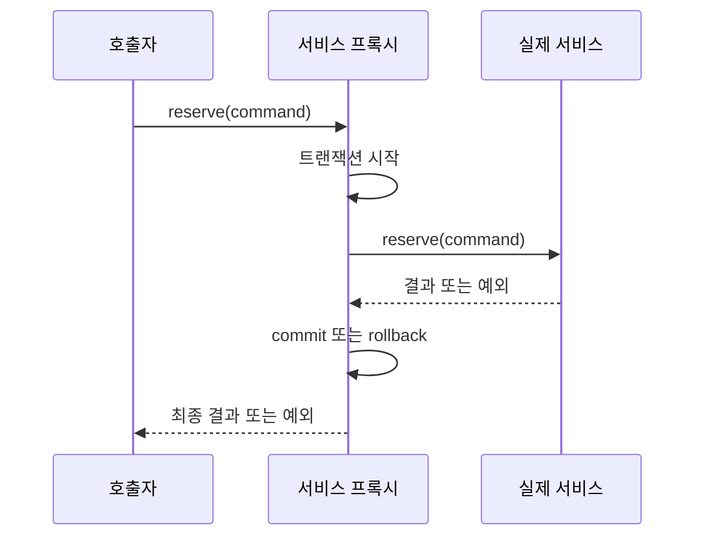

> PART 1. Spring의 핵심 원리

## 도입: 같은 메서드인데 어디서 부르느냐에 따라 롤백이 다르다

컨트롤러가 서비스의 `save()`를 호출하면 롤백된다. 그런데 서비스의 `saveAll()`이 내부에서 `save()`를 호출하면 롤백되지 않는다. 두 코드에 같은 어노테이션이 붙어 있어도 **호출이 어느 객체를 통과했는가**가 다르다. AOP를 제대로 이해하면 이 차이가 자연스럽다.

## 5.1 용어를 호출 구조에 연결한다

**Aspect**는 공통 관심사를 묶은 단위다. **Advice**는 실행할 부가 동작이다. **Pointcut**은 어떤 실행 지점에 Advice를 적용할지 고르는 조건이다. **Join Point**는 부가 동작을 적용할 수 있는 실행 지점이며 Spring AOP에서는 주로 메서드 실행을 다룬다. **Target**은 원본 업무 객체이고 **Proxy**는 호출 앞에서 부가 동작을 적용하는 대리 객체다.



Before는 실행 전, AfterReturning은 정상 반환 후, AfterThrowing은 예외가 전파될 때, Around는 호출 전후를 감싸는 방식이다. Around에서 `proceed()`를 호출하지 않으면 원본 메서드가 실행되지 않는다. 예외를 삼키면 호출자와 바깥 Advice가 실패를 알지 못할 수 있다.

## 5.2 JDK 동적 프록시와 CGLIB

JDK 프록시는 인터페이스를 구현하는 대리 객체를 만든다. 호출자는 인터페이스 타입을 기준으로 사용한다. CGLIB 방식은 대상 클래스의 하위 클래스를 생성하므로 상속·오버라이드 제약을 받는다. Boot의 일반적인 AOP 자동 설정은 클래스 기반 프록시를 기본으로 선택하지만, Framework 자체의 기본 선택 규칙과 모든 라이브러리의 프록시를 하나로 단정하지 않는다.

클래스 기반 프록시에서 final 클래스는 상속할 수 없고 final 메서드는 오버라이드할 수 없다. private 메서드는 프록시로 가로챌 대상이 아니다. JDK 프록시의 경우에는 인터페이스에 드러난 호출 경계를 보아야 한다. “final이면 어떤 프록시든 무조건 안 된다”처럼 범위를 넓혀 말하지 않는다. [프록시 메커니즘](https://docs.spring.io/spring-framework/reference/core/aop/proxying.html)을 기준으로 구분한다.

## 5.3 자기 호출은 왜 빠지는가

```java
public boolean self() {
    return active(); // 실제 객체의 this.active()
}

@Transactional
public boolean active() {
    return TransactionSynchronizationManager.isActualTransactionActive();
}
```

외부 호출자가 주입받은 프록시에서 `active()`를 호출하면 인터셉터가 개입한다. 반면 실제 객체 안의 `self()`가 `active()`를 직접 호출하면 프록시로 다시 들어가지 않는다. 위 코드의 실제 import·빈 등록·테스트는 [TransactionTests](../examples/reservation-api/src/test/java/com/example/reservation/TransactionTests.java)에 있다.

단, 자기 호출 시 항상 트랜잭션이 없다는 말도 틀릴 수 있다. 바깥 메서드가 이미 트랜잭션 안에서 실행됐다면 그 기존 트랜잭션은 유지된다. 빠지는 것은 안쪽 메서드에 선언한 **새로운 전파·롤백·격리 설정의 적용**이다. 특히 내부의 REQUIRES_NEW가 실행됐다고 착각하기 쉽다.

해결 방법은 책임이 다른 트랜잭션 동작을 별도 빈으로 분리해 외부 호출 경계를 만들거나, `TransactionTemplate`으로 코드에 경계를 명시하는 것이다. 자기 자신을 주입하거나 현재 프록시를 직접 조회하는 방법은 구조를 더 결합시키므로 기본 해법으로 삼지 않는다.

## 5.4 AOP와 다른 가로채기 도구

Servlet Filter는 HTTP 요청·응답 경계를, MVC Interceptor는 핸들러 실행 경계를, AOP는 빈 메서드 실행 경계를 다룬다. 로그인 검사를 세 도구에 중복 구현하면 정책이 어긋날 수 있다. 보안 필터 체인으로 인증을 처리하고, 업무 객체 권한은 서비스나 조회 조건에서 보장하는 식으로 책임을 정한다.

AspectJ weaving은 클래스의 바이트코드 등에 결합하는 별도 방식이다. Spring AOP의 자기 호출 제약을 설명할 때 weaving 환경까지 같은 제약이라고 일반화하지 않는다. 이 책의 실습은 기본적인 프록시 방식이다.

## 5.5 순서가 보장을 바꾼다

재시도 Advice 바깥에 트랜잭션이 있으면 여러 재시도가 이미 실패한 한 트랜잭션을 공유할 수 있다. 반대로 재시도 루프가 트랜잭션 경계 바깥에 있으면 매 시도마다 새 트랜잭션을 만들기 쉽다. 어노테이션 나열 순서가 실행 순서를 결정한다고 생각하지 말고 실제 Advice 순서와 프록시 경계를 확인한다.

로깅 Advice의 “성공”도 어디에 위치하는지 중요하다. 원본 메서드 반환을 기록한 로그라면 commit 성공 기록과 다를 수 있다. 메트릭의 측정 구간도 호출자 관점에서 정의한다.

## 실습: true와 false의 이유를 말한다

`mvn -Dtest=TransactionTests test`를 실행한다. `externalInvocationIsTransactional`은 true, `selfInvocationDoesNotStartTransaction`은 false를 기대한다. 두 테스트에는 테스트 메서드 자체의 `@Transactional`이 없다. 테스트가 바깥 트랜잭션을 먼저 열면 자기 호출 문제가 가려질 수 있기 때문이다.

확장 실습으로 `self()`에도 `@Transactional`을 붙이면 안쪽 active는 true가 될 수 있다. 이는 안쪽 어노테이션이 적용된 증거가 아니라 바깥 트랜잭션이 존재한다는 증거다. 트랜잭션 이름·새 연결 사용 여부를 추가로 측정해야 전파를 구분할 수 있다.

## 확인 문제와 해설

**Q1. `new ReservationService(repo)`에도 선언형 트랜잭션이 동작하는가?** 순수한 직접 생성 객체에는 일반적인 Spring 프록시가 없으므로 동작하지 않는다. 단위 테스트와 프록시 통합 테스트의 목적을 구분한다.

**Q2. private 메서드에 선언하면 왜 기대한 효과가 없는가?** 기본 프록시가 호출을 가로채는 경계를 제공하지 못하기 때문이다. public 서비스 경계를 명확히 설계한다.

**Q3. 응답 시간 Advice가 정상 종료됐는데 commit 오류가 날 수 있는가?** Advice 순서에 따라 가능하다. 어떤 경계를 측정했는지 확인해야 한다.

## 참고자료

- [Spring AOP 개념](https://docs.spring.io/spring-framework/reference/core/aop/introduction-defn.html)
- [선언형 트랜잭션 구현 이해](https://docs.spring.io/spring-framework/reference/data-access/transaction/declarative/tx-decl-explained.html)

---

[전체 목차](../index.md) · [← 이전 장](../04-container-lifecycle/chapter.md) · [다음 장 →](../06-psa-auto-configuration/chapter.md)
